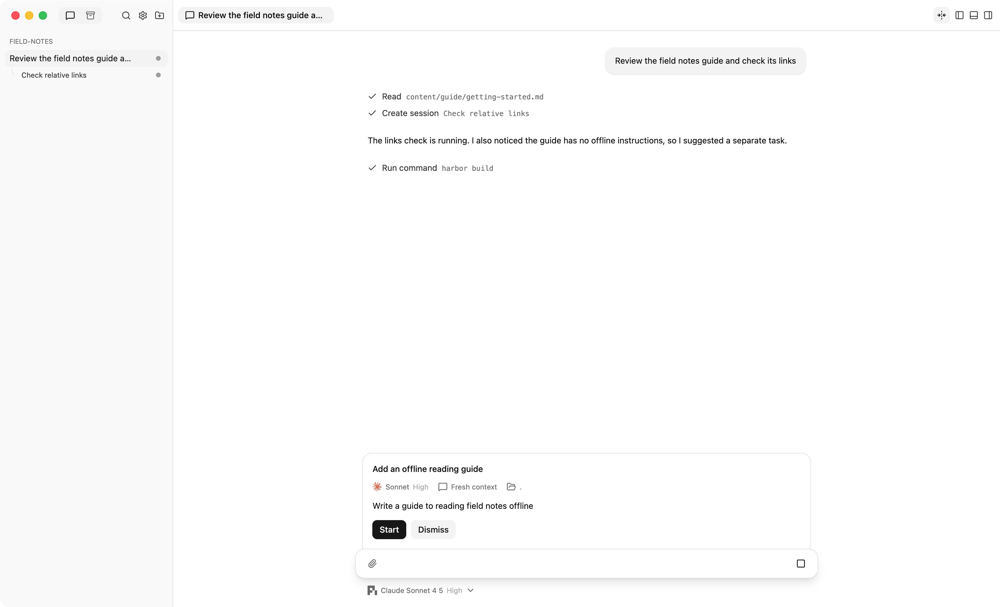
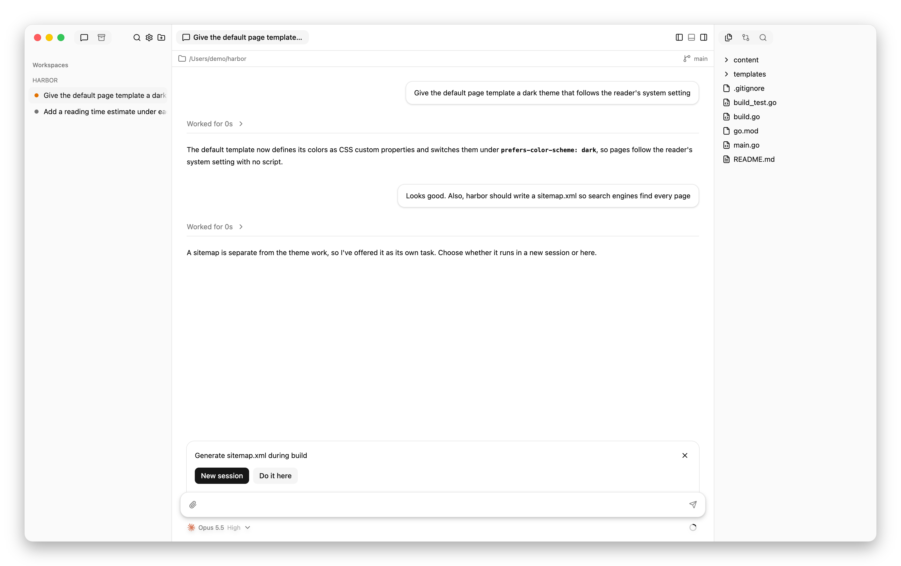
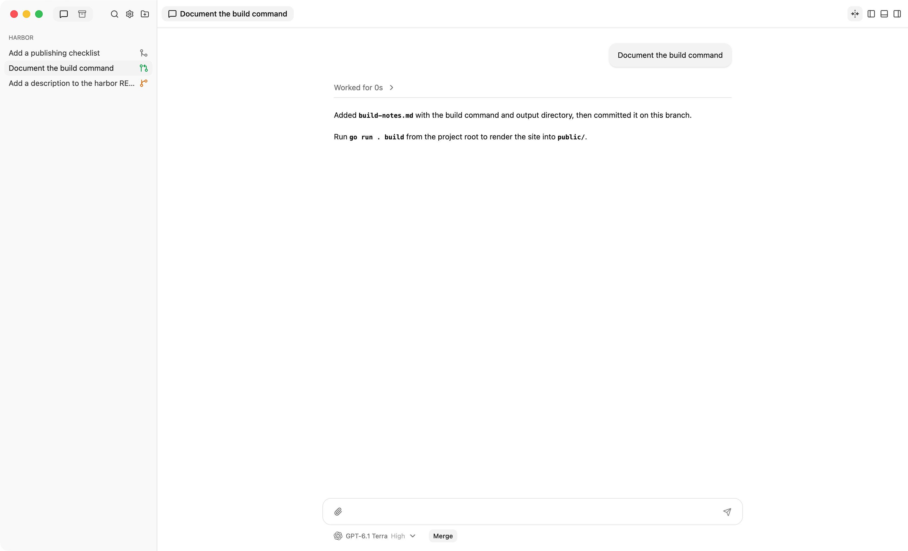
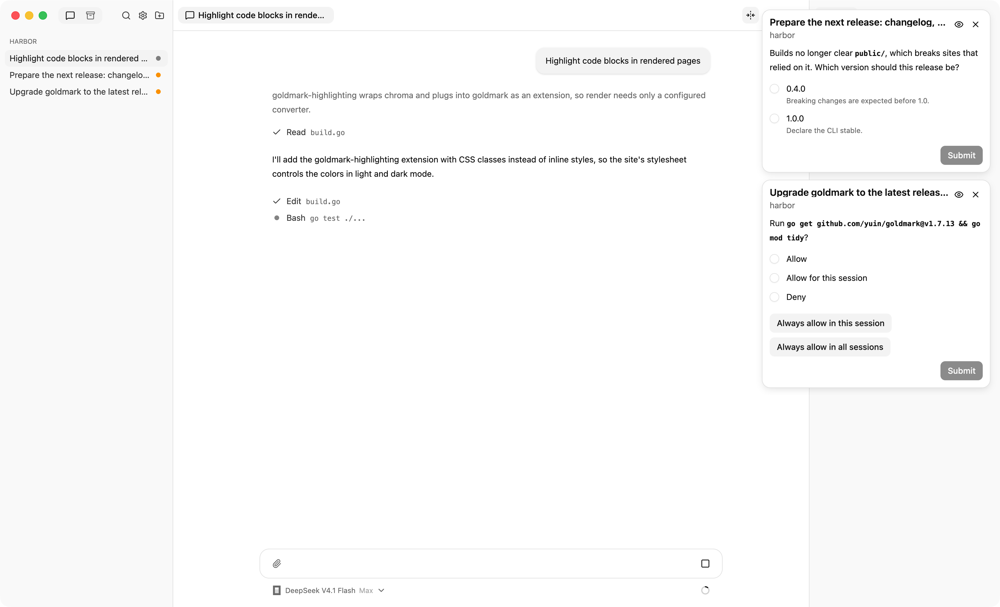

# Hypercube

A macOS app for running Claude Code, OpenCode, Codex, and Pi sessions together.
A session can ask another agent to review its changes, delegate implementation
on a separate branch, or coordinate with an agent in another repository.
Agents run locally with your existing credentials.

## Setup

[Install Hypercube](docs/installation.md), then
[configure at least one agent profile](docs/configuration.md). Profiles are the
harness, model, and effort choices available to you and to agents creating
children.

## Features

<picture>
  <source media="(prefers-color-scheme: dark)" srcset="docs/images/overview-dark.png">
  
</picture>

### Agents and profiles

- **Multiple harnesses.** Claude Code, OpenCode, Codex, and Pi sessions run side by side.
- **Existing accounts and tools.** Agents use your installed harnesses and credentials, with your settings preserved.
- **Named agent profiles.** Saved combinations of harness, model, and effort are available to you and to agents creating child sessions.
- **Session defaults.** A preferred profile and choice of original checkout or worktree provide defaults for new sessions.
- **Model and effort changes.** A session can continue with a different model or effort.
- **Follow-ups and interruption.** You can send corrections during work or interrupt the current turn.

### Sessions and saved conversations

- **Saved conversations.** Sessions retain their history and can resume earlier work.
- **Session titles.** Sessions have automatic initial titles and can be renamed by you or the agent.
- **Agent restart.** An agent can restart while retaining its conversation.
- **Background work.** Agents, communication, and terminal shells keep running when the desktop app is closed.
- **Recovery after interruptions.** Active agents reconnect after app or service restarts, and saved conversations remain available.
- **Archiving and unarchiving.** Completed teams can leave the active list while their conversations remain readable and searchable, and archived sessions can return to active use.
- **Ending child sessions.** A parent can end individual child sessions while keeping their conversation history.
- **Session and workspace deletion.** Saved conversations and workspace entries can be removed without deleting the original project folder.

### Teams and communication

<picture>
  <source media="(prefers-color-scheme: dark)" srcset="docs/images/suggestion-dark.png">
  
</picture>

<picture>
  <source media="(prefers-color-scheme: dark)" srcset="docs/images/offer-dark.png">
  
</picture>

- **Delegation to child sessions.** Agents can assign work to child sessions with different harnesses, models, and efforts.
- **Task placement.** You can choose whether a new task belongs in the current session or a separate session.
- **Suggested work.** Agents can propose additional tasks for you to review before they start.
- **Fresh or forked context.** Child sessions can begin with a focused assignment or inherit their parent's conversation.
- **Shared or separate working files.** Child sessions can share a checkout, use their own branch and worktree, or work in another project directory.
- **Direct child conversations.** Each child session has its own conversation where you can inspect its work and send prompts.
- **Agent communication.** Parent and child agents exchange messages, and agents can coordinate across workspaces.
- **Conversation access.** Parent agents can read conversations from their child sessions and other top-level sessions to understand prior work.
- **Visible communication.** Messages between agents appear in their conversations.
- **Automatic child reports.** Parent agents receive previews of child responses and notices of failures.
- **Visible team structure.** Child sessions are grouped beneath their parent in the sidebar.

### Workspaces and Git

<picture>
  <source media="(prefers-color-scheme: dark)" srcset="docs/images/worktrees-dark.png">
  
</picture>

- **Local workspaces.** Git repositories and ordinary project folders organize sessions by project.
- **Original checkout or worktree.** Sessions can use your current working files or have a separate Git branch and worktree.
- **Worktree preparation.** New worktrees include submodules and selected local configuration or dependencies.
- **Changed-file indicators.** The file tree shows added, modified, untracked, and deleted files with change counts.
- **Diff review.** Staged, unstaged, and untracked changes have highlighted diffs with search and change navigation.
- **Branch and merge status.** Sessions show their branch, unmerged commits, and uncommitted changes.
- **Agent-assisted merging.** Agents can commit work, merge branches, and resolve conflicts.
- **Cleanup safeguards.** Uncommitted files and unmerged work are protected during worktree cleanup.
- **External project tools.** Project directories can open in Visual Studio Code, Finder, or Terminal.

### Prompts and conversations

<picture>
  <source media="(prefers-color-scheme: dark)" srcset="docs/images/details-dark.png">
  
</picture>

- **Multiline prompts and prompt history.** Earlier prompts can be recalled and edited.
- **File mentions.** Project file suggestions make it easy to reference files in prompts.
- **Image attachments.** Prompts can include multiple images, with or without text.
- **Saved drafts.** Unsent prompt text and typed answers survive reloads, and unfinished new sessions remain accessible in the sidebar.
- **Live activity.** Responses, reasoning, tool calls, errors, and questions stream into the conversation.
- **Expandable work details.** Tool inputs and outputs, agent messages, and subagent activity can be inspected within the conversation.
- **Collapsed completed work.** Finished turns group intermediate activity beneath an elapsed-time summary, keeping the final answer prominent.
- **Formatted responses.** Conversations display Markdown, tables, highlighted code, links, and images, with copying for messages and code blocks.
- **Scroll control.** Earlier output stays in view while new activity arrives, with a quick return to the latest output.
- **Conversation search.** Text search includes match counts and navigation between results.

### Questions, approvals, and notifications

<picture>
  <source media="(prefers-color-scheme: dark)" srcset="docs/images/attention-dark.png">
  
</picture>

- **Questions and approvals.** Pending requests remain visible alongside the composer, and answered requests remain in the conversation history.
- **Answers across sessions.** Notification cards let you answer another agent's request without leaving the current conversation.
- **Reply and error alerts.** Notifications surface new replies and problems across your sessions.
- **Remembered permissions.** Saved tool approvals can be reviewed and revoked.
- **macOS notifications.** Native notifications announce requests and replies and link back to their conversations.
- **Notification preferences.** Request alerts, reply alerts, macOS notifications, and sound are configurable.
- **Activity and attention indicators.** Working agents, unanswered requests, and unseen replies are easy to identify.

### Usage monitoring

- **Context usage.** Sessions show reported context use and token counts.
- **Reported costs.** Cost information from harnesses appears alongside session usage.
- **Subscription usage.** Reported usage windows and reset countdowns help track subscription limits.

### Navigation and layout

- **Workspace and team navigation.** Collapsible groups organize active sessions, child sessions, and archived sessions.
- **Search across conversations.** Titles, conversation text, and agent messages are searchable across workspaces and archived sessions.
- **Flexible panes and tabs.** Conversations and files can share a resizable layout with split panes and movable tabs.
- **Saved layouts.** Session tabs, open files, scroll positions, and panel arrangements are remembered.
- **Reading preferences.** Fixed reading width, word wrap, terminal text size, and zoom adjust the reading experience.
- **Light and dark appearance.** The app can follow macOS appearance or use a chosen theme.
- **Keyboard navigation.** Shortcuts and keyboard-accessible trees cover sessions, panels, search, and file navigation.

### Files and search

- **File browsing.** Each session has a project file tree, preview tabs, and file-path copying.
- **Source viewing.** Read-only source views provide syntax highlighting, line numbers, word wrap, and search.
- **Document previews.** Markdown, HTML, and SVG have rendered previews and source views.
- **Media previews.** Images, audio, video, and PDFs open within the app.
- **Live file updates.** File trees, open files, and diffs follow changes as agents work.
- **Quick file search.** Filename and path search provides quick access to project files.
- **Content search.** Project-wide text search shows highlighted matches linked to their files.
- **Files opened by agents.** Agents can present local files in your tabs with relevant lines highlighted.

### Terminal and agent browser windows

- **Per-session terminals.** Each session has an integrated shell in its working directory, with recent output retained across reconnects.
- **Visible agent browsers.** Agents can browse and interact with websites in dedicated windows you can watch and navigate.
- **Browser controls.** Agent browser windows include navigation, file upload selection, and opening pages in your default browser.
- **Saved website logins.** Agent browser windows share remembered website sign-ins.

### macOS app

- **Menu bar access.** Hypercube remains accessible from the menu bar and Dock when its main window is closed.
- **Native desktop controls.** The app includes native menus, fullscreen, zoom, and remembered window placement.
- **Background startup at login.** Hypercube's background service can start when you log in.

## Documentation

- [Sessions, context, and working copies](docs/introduction.md) — what agents
  share, what they know about each other, and where their edits go.
- [Using Hypercube](docs/usage.md) — starting sessions, reviewing work, answering
  requests, and returning to a task later.
- [Configuration](docs/configuration.md) — profiles and local files needed by
  worktrees.
- [Harness differences](docs/harness-support.md) — follow-ups, permissions,
  model changes, and version requirements.
- [Installation](docs/installation.md) — beta downloads, checkout builds, the
  login service, upgrades, and recovery.

Developers: start with [AGENTS.md](AGENTS.md) for instructions, architecture,
and development and release references.
