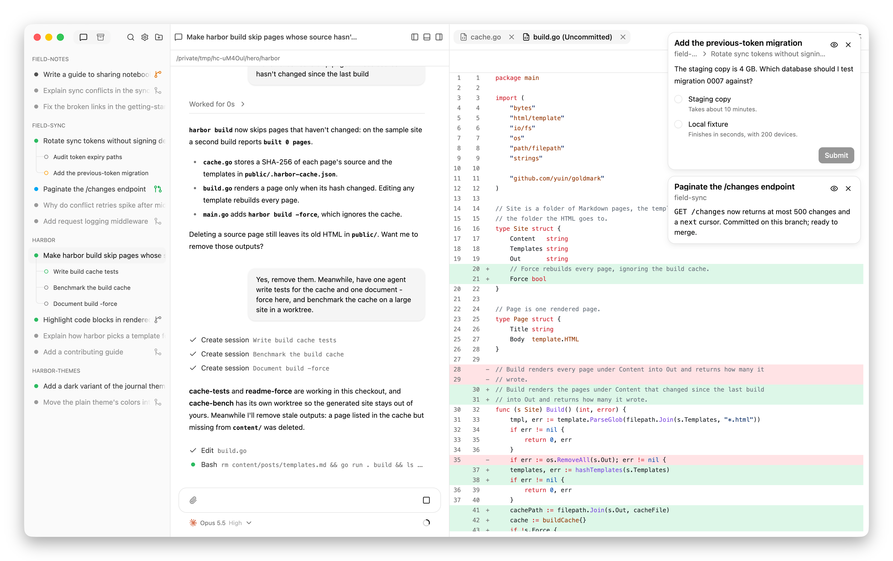

# Hypercube

Run Claude Code, OpenCode, and Pi together in a macOS or Linux app.
Ask an agent to delegate a task, get a second opinion, or review another
agent's work. Each session has its own conversation; you choose whether agents
share working files or use separate Git branches.

Agents run locally with your installed coding tools and existing credentials.
They can keep working after you close the app.

<picture>
  <source media="(prefers-color-scheme: dark)" srcset="docs/images/hero-dark.png">
  
</picture>

## Start here

Browse the [documentation index](docs/index.md) for all user and developer docs.

1. [Install Hypercube](docs/installation.md).
2. Follow [Your first session](docs/getting-started.md) to explore a project
   without changing files.

You need an installed, authenticated coding tool. See
[supported harnesses](docs/harness-support.md#requirements) for requirements.

## How-to guides

Choose the task you want to complete:

- [Manage sessions](docs/usage.md) — add workspaces; start, steer, resume, and archive work.
- [Work with a team](docs/teamwork.md) — delegate, review, and merge changes.
- [Branch, merge, and use worktrees](docs/workflows.md) — Git workflows from
  feature branches to pull requests.
- [Review files and changes](docs/review-changes.md) — inspect output beside chat.
- [Upgrade Hypercube](docs/upgrades.md).
- [Troubleshoot Hypercube](docs/troubleshooting.md) — fix setup, start, and cleanup errors.

## Reference

Look up a setting, capability, shortcut, or path:

- [Configuration](docs/configuration.md)
- [Harness differences](docs/harness-support.md)
- [Interface reference](docs/interface.md)
- [Files and storage](docs/storage.md)

## Explanation

Understand the choices behind a workflow:

- [Sessions, context, and working copies](docs/introduction.md)
- [What keeps running when you leave](docs/lifecycle.md)

## Contributing

Building or changing Hypercube? Start with [Contributing](CONTRIBUTING.md).
User guides above do not require a source checkout.

Report bugs and request features in
[GitHub Issues](https://github.com/kkestell/hypercube/issues).
