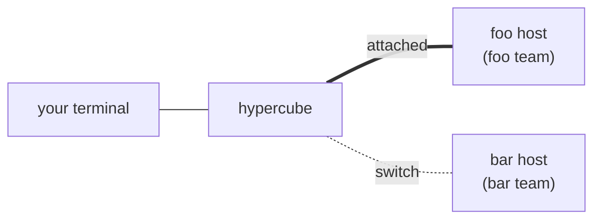
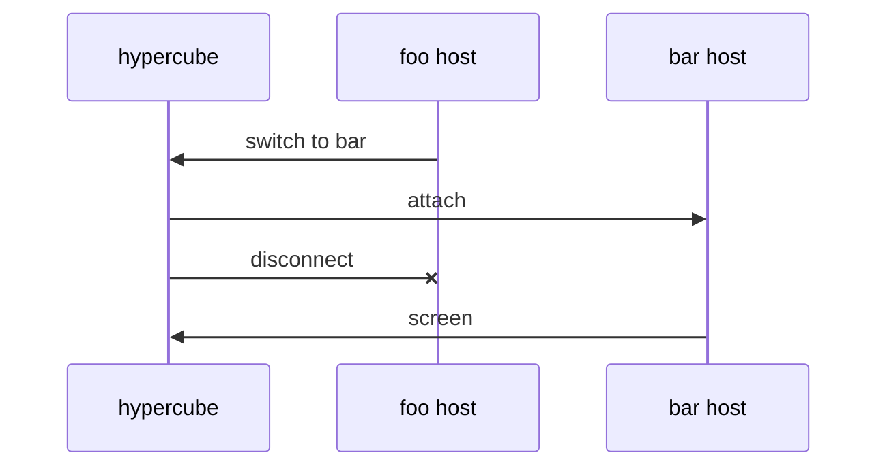

# Persistent sessions

## Goal

A workspace's team runs in a background host process that outlives the
terminal. `hypercube` is a client: it attaches the user's terminal to the
workspace's host, starting the host if none is running. Closing the window,
SIGHUP, or the end of input detaches the client; the team keeps running. A
workspace overlay lists every workspace with a state file and switches the
terminal between them without leaving `hypercube`. A host ends only on
`hypercube stop`, `hypercube delete`, the overlay's stop key, or a signal.

## Overview

`hypercube` in your terminal shows one team at a time. Every team runs in its
own background host, attached or not. The diagrams use two example
workspaces, the checkouts `~/src/foo` and `~/src/bar`.

Switching teams moves the client's connection; neither host stops.

## Related code

- `src/host.rs` — `run` takes the host lock, requires a tty, and builds `Mux`
  and `Runtime` on fds 0 and 1. `Host::serve` ends on `InputClosed`, signals,
  `stop`, and when every pane has exited. `Host::end` restores the terminal.
  `running` returns the terminal name written into the host lock.
- `src/runtime.rs` — `Runtime` owns the tty: `new` (raw mode, alternate
  screen, `query_host`), `host_size`, `restore`, and `wait`, which polls host
  input, winch, panes, and the caller's fds, and writes frames with
  `write_all`.
- `src/mux.rs` — `Mux` renders into `Shared::out` (`take_output`). Per-tty
  state: `host_modes`, `host_kitty_flags`, `host_any_motion`,
  `grapheme_default`, `press`, `selection`, `held_input`, `held_since`,
  `pasting`. `host_replies` answers pane programs' color queries.
  `repaint` makes the next frame clear and draw every row. The bell and title
  callbacks (`new_terminal`), `Pane::feed`'s notification scan, `set_focus`'s
  title, and the clipboard copy (~L1418) append to `Shared::out` outside
  `render`. `ctrl_key` and `classify` route Ctrl-] and Ctrl-\. `host_restore`
  resets mirrored modes and leaves the alternate screen. `write_all` (~L1957)
  retries `EAGAIN` in a loop.
- `src/winch.rs` — SIGWINCH through a pipe; moves to the client's use only.
- `src/control.rs` — `Request`, `Reply`, `socket_path`, `request`.
- `src/main.rs` — `start` calls `host::run`; `Known`, `workspaces`, and
  `status` list workspaces; `stop_workspace` and `delete_workspace` use
  `host::running`.
- `tests/live.rs` — `Host` builds a `Runtime` on a pty slave standing in for
  the user's terminal.
- `tests/integration.rs` — `Fixture::start` runs `hypercube` in a pty;
  `Fixture::stop`, `wait_host_exit`, and `Drop` assume the host is that
  process.

## Decisions

- **One host per workspace.** Each host keeps the existing host lock, socket,
  and state file, so `stop`, `delete`, the MCP server, and hooks find it as
  they do now. A host failure affects one team. A host inherits the
  environment of the client that spawned it, including a host spawned for an
  overlay switch; reattaching doesn't change it.
- **The client owns the tty.** It is the only process that changes terminal
  settings or writes to the tty. Hosts send rendered bytes over the socket.
  Switching changes the client's connection, not who owns the terminal, and a
  host that dies leaves a client that can still restore the terminal.
- **The client queries the terminal once.** It sends the replies with every
  attach. The host keeps the replies from its most recent attach in
  `Mux::host_replies`, so harnesses relaunched while detached still get
  answers. A new host launches no harness until its first attach supplies
  replies and a size. Hosts are spawned only by a client, which attaches right
  away.
- **Attach stream.** The first line on a socket connection selects one of two
  modes: a one-shot JSON request, or `{"request":"attach","protocol":N,
  "size":{...},"replies":"..."}`. After the host replies `{"ok":true}`, the
  connection carries `link::Message` values, each encoded as one kind byte, a
  4-byte big-endian length, and the payload, up to 1 MiB:
  - client → host: `Input(bytes)`, `Resize(Winsize)`, `SwitchFailed(text)`
  - host → client: `Output(bytes)`, `Switch(dir)`, `Detached(reason)`

  The host rejects a different `link::PROTOCOL` with an error telling the user
  to stop that workspace and start it again. Hosts are never stopped
  automatically.
- **Single attachment.** A new attach sends `Detached("attached in another
  terminal")` to the current client and drops it. The client prints the
  reason, restores the terminal, and exits 0.
- **Mux connect and disconnect.** The per-tty fields move into
  `mux::HostTerminal`, held as `Option<HostTerminal>`. `Mux::connect_host`
  creates it from the replies and size, resets the mirrored modes to
  defaults, and calls `repaint`, so the first frame is a full paint plus a
  full mode sync. `Mux::disconnect_host` drops it and clears any Ghostty
  selection. The pane state stays with each pane across detaches: the
  terminal, scrollback, size, hold, and the `Frame` snapshot taken when a hold
  begins. While no host terminal is connected, `render` draws nothing,
  `input` is not called, and side output is discarded.
- **Side output.** The title is written in `render` when the focused pane's
  title changed, instead of from the callback. A bell sets a flag, and
  `render` writes one BEL. Notifications and clipboard copies are appended
  whole to `Shared::out` only if it stays under `MAX_SIDE_OUTPUT` (256 KiB);
  past that limit they are dropped whole.
- **Render when written.** `Runtime` keeps the outbound messages queued on the
  link and polls it for `POLLOUT` while the queue is non-empty. It renders a
  frame only when the queue is empty and `FRAME_MS` has passed. Changes pile
  up in the Ghostty terminals in the meantime, so a slow client gets fewer
  frames. Each frame is one `Output` message holding whole escape sequences
  inside a balanced mode 2026 block. A link whose queue makes no progress for
  `LINK_STALL_MS` (10 s) is disconnected. The host never blocks on the link.
- **Client writes whole messages.** The client writes each `Output` payload
  completely to the tty before it reads the next message. A blocked tty
  therefore stops it from reading the socket, which applies backpressure to
  the host. A switch always happens between two complete payloads.
- **Losing the terminal detaches.** On end of input, SIGHUP, or a socket
  error, the client exits, and the host drops its attachment. The host
  ignores SIGHUP. It ends on SIGINT, SIGTERM, or `stop`. It keeps running when
  every agent has exhausted its relaunches.
- **Host lock.** It holds the host's pid instead of a terminal name.
  `host::running` returns `bool`.
- **Workspace overlay.** Ctrl-^ opens it: legacy byte `0x1e`, or Kitty key 54
  with Ctrl (modifiers 5) or Ctrl+Shift (modifiers 6). While it is open:
  - Layout: the host lays every pane out hidden (`hidden`), so the panes keep
    their sizes, and `TeamChrome` draws the overlay across the whole screen.
  - Input: `Mux::set_captured(true)` reports each key as `Event::Key(bytes)`
    instead of routing it to a pane. It drops pastes and mouse reports, and
    mirrors default modes, so keys arrive in legacy form.
  - List: one row per workspace from `store::workspaces`, sorted by last
    activity, showing the name, running or stopped, the agent count, the
    number of busy agents, and the last activity. The current workspace is
    marked. The list is read again every second while the overlay is open.
  - Keys: Up/Down or k/j move. Enter switches to the selected workspace (on
    the current one, it closes the overlay). `x` stops the selected running
    workspace; stopping the current one ends this host and the client. `d`
    detaches. Esc or Ctrl-^ closes the overlay.
  - Errors: a failed switch or stop shows its error in the overlay's last row.
- **Spawning a host.** The client runs `hypercube host <root>` with
  `setsid`, stdin from `/dev/null`, and stdout and stderr appended to
  `<name>.log` in the state directory. It retries connecting to the socket
  every 50 ms for up to 5 s. If the host exits first, or the time runs out,
  the error includes the last lines of the log.

## Test plan

- `link`:
  - Each message round-trips through `encode` and the decoder, including
    reads split at every byte boundary.
  - A message over 1 MiB is an error.
  - A non-blocking `Link` queues writes on `EAGAIN` and reports
    `pending()`.
- `mux` unit tests:
  - `connect_host` makes the next render clear the screen and write every
    mirrored mode, mouse mode, and the Kitty flags, even when they match what
    an earlier connection had.
  - While disconnected, bells, titles, notifications, and clipboard copies
    produce no output, and `render` produces none.
  - Many bells between frames produce one BEL, and many title changes produce
    one title.
  - Notifications past `MAX_SIDE_OUTPUT` are dropped whole.
  - `disconnect_host` during a selection clears it, and during a drag ends the
    press.
  - A pane in a mode 2026 hold across disconnect and connect draws its
    snapshot.
  - Captured input reports keys as `Event::Key` and nothing reaches the
    focused pane. The overlay key is recognized in legacy and Kitty forms.
- `overlay` unit tests:
  - Drawing lists running and stopped workspaces, marks the current one, and
    clips names to whole grapheme clusters.
  - Up/Down/j/k move and stop at the ends.
  - Enter on another workspace returns a switch, Enter on the current one
    closes the overlay, and `x`, `d`, and Esc map to stop, detach, and close.
  - An error shows in the last row.
- `tests/live.rs`:
  - The `Host` fixture runs `client::proxy` in a thread on the pty slave,
    linked to the runtime by a socket pair. Existing tests pass through that
    path.
  - Detaching and attaching again gives a screen and mirrored modes identical
    to those before the detach.
  - A client that stops reading the link doesn't stop pane input from being
    written or reaped exits from being reported. Once it reads again, its
    screen shows the latest pane contents.
  - A link with no progress for `LINK_STALL_MS` is disconnected; the test sets
    the constant low through `Runtime::set_stall_ms`.
- `tests/integration.rs`:
  - `Fixture` records the host pid from the host lock, and its `Drop` stops
    the host.
  - Closing the client's pty leaves the host and the stand-ins running, and
    `status` shows `running`.
  - Running `hypercube` again shows the same panes, with no relaunch.
  - A second client takes the attachment; the first prints "attached in
    another terminal" and exits 0.
  - In two repositories, Ctrl-^ lists both, Enter switches to the other
    team's panes, and switching back shows the first team unchanged.
  - Switching to a stopped workspace starts its host.
  - `x` in the overlay stops a workspace, and stopping the current one ends
    the client with "stopped".
  - `hypercube stop` from another shell ends the attached client with
    "stopped".
  - With every agent exhausting its quick exits, the host keeps running.
  - A host whose `PROTOCOL` differs is refused with the stop-and-start-again
    error; the test fakes the host with a socket that answers the attach with
    that error.
  - Existing tests that ended the session by closing input stop it with
    `hypercube stop` instead.

## Implementation plan

1. `src/link.rs` (new, terminal layer): `PROTOCOL`, `Message`,
   `encode`, and a `Decoder` that accumulates bytes and yields whole
   messages. `Link` wraps a non-blocking `UnixStream` with an outbound queue:
   - `send(Message)`
   - `flush() -> io::Result<bool>`, returning whether it made progress
   - `pending()`
   - `read() -> io::Result<Vec<Message>>`, with `Ok` empty on `EAGAIN`, and
     an error at the end of the stream
   - `last_progress`

   The client uses the same encoder and decoder over a blocking stream.
2. `src/mux.rs`:
   - Move the per-tty fields into `HostTerminal`, and add `connect_host(replies,
     ws)`, `disconnect_host()`, and `connected()`. `use_host_replies` becomes
     part of `connect_host`; `host_replies` stays on `Mux`.
   - Make the bell and title coalesce as described above. Bound the other side
     output with `MAX_SIDE_OUTPUT`, and discard side output while
     disconnected (`Shared` gets a `connected` flag that the callbacks read).
   - Add `set_captured` and `Notice::Key(Vec<u8>)`, and treat the focus as
     `None` for `sync_modes` while captured.
   - Add `Route::Overlay` and `Notice::Overlay`, with the overlay key in
     `classify` and `ctrl_key`.
   - Split `host_restore` into `host_reset`, which resets modes, the cursor,
     and SGR and stays in the alternate screen, and `host_restore`, which is
     `host_reset` plus leaving the alternate screen.
   - Make `write_all` blocking-only. The client uses it on the tty, and the
     host no longer calls it.
3. `src/runtime.rs`:
   - Remove the tty: drop `input`, `output`, `termios`, `clusters`, `winch`,
     `query_host`, `host_size`, and `restore`. `Runtime::new()` takes no fds.
   - Add `connect(mux, link, replies, ws)`, `disconnect(mux)`,
     `send(Message)`, and `connected()`.
   - `wait` polls the panes, the caller's fds, and the link, with `POLLOUT`
     while the link has a queue. It feeds `Input` to `mux.input`, and
     `Resize` to `mux.resize` plus `Event::Resized`. It returns `Switch`,
     `SwitchFailed`, and `Detached` as `Event::Message`, and end of stream,
     errors, and stalls as `Event::Disconnected` after disconnecting. It
     renders only when connected, the queue is empty, and `FRAME_MS` has
     passed, then sends `take_output()` as one `Output` message.
   - Add `Event::Key`, `Event::Overlay`, `Event::Message`, and
     `Event::Disconnected`, and remove `Event::InputClosed`. `Event` loses
     `Copy`.
4. `src/client.rs` (new):
   - `run(root)` requires a tty on stdin and stdout and finds or spawns the
     host (`spawn_host`). It then takes over the terminal with the code moved
     from `Runtime::new`, `query_host`, and `restore`: raw mode, the alternate
     screen, the queries, and SIGWINCH through `winch`. It attaches and calls
     `proxy`.
   - `proxy(tty_in, tty_out, stream)` polls the tty input, winch, and the
     socket.
     - Input goes out as `Input`, and a new size as `Resize`.
     - `Output` is written whole to the tty.
     - For `Switch(dir)`, it attaches to that workspace's host, spawning it
       if needed. On success it drops the old stream, writes `host_reset`,
       and continues. On failure it sends `SwitchFailed`.
     - For `Detached(reason)`, end of input, SIGHUP, or end of stream, it
       restores the terminal, prints the reason if there is one, and returns.
   - `attach(socket, ws, replies)` sends the attach request and reads the
     reply.
5. `src/control.rs`: add `Request::Attach { protocol, size, replies }`.
   `Winsize` serializes through a small `Size` struct with cols, rows,
   xpixel, and ypixel.
6. `src/store.rs`: move `Known` and `workspaces` from `main.rs` into
   `store::workspaces() -> Vec<Workspace>`, with `root()` and `name()`, so
   `status`, `stop --all`, `delete --all`, and the overlay share them.
7. `src/overlay.rs` (new):
   - `Overlay` holds the list, the selection, the current workspace's state
     path, and the error row.
   - `Overlay::load(current)` reads `store::workspaces` and `host::running`.
   - `Overlay::key(&[u8]) -> Action` returns `Move`, `Switch(PathBuf)`,
     `Stop(PathBuf)`, `Detach`, `Close`, or `None`.
   - `Overlay::draw(out, size)` draws the list.
8. `src/host.rs`:
   - Rename `run` to `serve_workspace(root)`. It takes the lock, writes the
     pid into it, prepares the state, listens on the socket, ignores SIGHUP,
     and catches SIGINT and SIGTERM. It builds `Mux` and `Runtime::new()`
     with no tty and launches no agents until the first attach.
   - `read_client` handles `Request::Attach`:
     - It checks `protocol` and replies.
     - It sends `Detached` to any current link and disconnects it.
     - It calls `runtime.connect`.
     - On the first attach, it runs `start(&agents)`; otherwise it calls
       `lay_out`.
   - `serve` handles `Event::Overlay` (open: load, `set_captured(true)`,
     hidden layout; close: the reverse plus `lay_out`) and `Event::Key`
     (`Overlay::key`).
     - `Switch(dir)` sends `Message::Switch(dir)`. The host then keeps the
       overlay open until the client either drops it or sends
       `SwitchFailed`, which sets the overlay's error.
     - `Stop(path)` calls `host::stop`, or ends the session when the path is
       its own.
     - `Detach` sends `Detached("")` and disconnects.

     `serve` refreshes the overlay every second while it is open. It ignores
     `Event::Disconnected` apart from closing the overlay. It drops the
     every-pane-exited exit.
   - `TeamChrome` gets `overlay: Rc<RefCell<Option<Overlay>>>` and draws it
     instead of the labels and separator when it is set.
   - `end` sends `Detached("stopped")` before hanging up the panes and no
     longer restores a terminal.
   - `running` returns `bool`. Remove `terminal_name`.
9. `src/main.rs`: `[]` runs `client::run(root)`, `["host", dir]` runs
   `host::serve_workspace`, and the `running` call sites use the `bool`. The
   `host` command stays out of `USAGE`.
10. `src/lib.rs`: declare `link`, `client`, and `overlay`.
11. `tests/live.rs`: rebuild `Host` around a socket pair, `client::proxy` in a
    thread on the pty slave, and `Runtime::connect`. Add the tests above.
12. `tests/integration.rs`: adapt `Fixture` to a detached host (pid from the
    host lock, `Drop` stopping the host, `wait_host_exit` on that pid). Add a
    second-repository helper and the tests above.

## Documentation updates

- `docs/architecture.md`:
  - Processes: add `hypercube host` and describe `hypercube` as the client.
  - The host: rewrite for a headless host, attach, detach, the first attach
    starting agents, ending only on `stop`, `delete`, or a signal, and the
    host lock holding the pid.
  - Add a section for the client and the attach stream with both diagrams.
  - Control socket: add `attach`.
  - Layout and chrome: add the overlay and its keys.
  - Terminal layer:
    - Runtime: the link replaces the host terminal, rendering waits for the
      link to drain, and the stall timeout.
    - Rendering: connecting and disconnecting the host terminal, and side
      output.
    - Input: the overlay key and captured input.
- `AGENTS.md`:
  - Layout: add `src/client.rs`, `src/link.rs`, and `src/overlay.rs`, and
    update `src/runtime.rs` and `src/host.rs`.
  - Principles: the host process is the background `hypercube host`, and the
    client runs in the user's terminal.
  - Smoke testing: stop each started host with `hypercube stop`, and delete
    its log file.
- `docs/installation.md`: after `make install`, running hosts keep the old
  binary until they are stopped.
