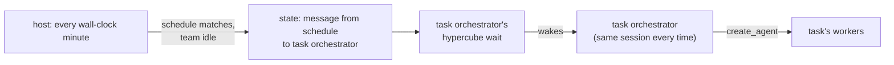

# Scheduled tasks

## Goal

The orchestrator creates, changes, lists, and deletes scheduled tasks through
MCP tools. A task has a name, a cron schedule, a prompt, and the profile its
orchestrator runs with. Each task has its
own orchestrator, the task orchestrator, with one persistent harness session:
every time the task fires, its prompt reaches that same session as a message,
the way any message wakes an idle agent. The task orchestrator can create
workers, which belong to the task's team. The header shows how many tasks the
workspace has, how many are running, and which teams out of view wait for a
tool approval. Ctrl-b t opens the team list: the main team, then the team of
each task under "Scheduled"; Enter views the selected team's panes, the task
orchestrator and its workers, in place of the main team's, and the same list
goes back. The workspace overlay counts the main team's agents and the tasks.

## Overview

A task is a team inside the workspace's host, not a separate workspace or
host. One team per task, persistent across firings: a firing is a turn in the
task orchestrator's session, not a new team. Workers it creates stay until it
removes them, as in the main team. Every team's agents run all the time; the
host shows one team's panes and keeps the others' panes sized and running in
the background.

## Related code

- `src/store.rs` — `Agent`, `State`, `Workspace::root` (finds the first
  orchestrator), `State::remove`, `State::take`.
- `src/mcp.rs` — `tools`, `Server::call`, `create_agent` (with its rollback),
  `remove_agent`, `list_agents`, `orchestrator`, `valid_name`.
- `src/hook.rs` — `facts` (the team list and the orchestrator's guidance),
  `format` (how a message reaches the model), `MESSAGE_TOOLS`.
- `src/host.rs` — `prepare` (sorts the orchestrator first), `start` (a failed
  orchestrator launch ends the session), `Slot`, `launch`, `close`,
  `finish_close`, `lay_out`, `place`, `hidden`, `read_bar` (refreshes the
  first slot's branch detail), `TeamChrome::draw` (the header row through
  `draw_row`, whose right text is unused), `toggle_overlay`, `close_screens`,
  `serve` (the loop's deadlines and events).
- `src/overlay.rs` — the workspace overlay, the pattern for the team list:
  rows, selection, `key` returning an action, `draw` over the whole screen.
- `src/mux.rs` — `Notice`, `Prefixed::typed`, the prefix handling around
  L1610 that toggles capture for `Overlay` and `Help`, `add_pane`'s
  auto-focus, `set_focus`, `focus_from`, `release_focus`, `set_layout`.
- `src/runtime.rs` — maps `Notice` to `Event` (~L183).
- `src/bar.rs` — `running` finds a workspace's root from the first
  orchestrator (~L263).
- `src/help.rs` — `KEYS`.
- `src/bin/hypercube-test-harness.rs` and `tests/integration.rs` — the
  stand-in calls MCP tools on command; `create_agent_adds_panes_and_worktrees`
  and `the_overlay_switches_between_workspaces` are the patterns for the new
  integration test.

## Decisions

- **Teams.** `Agent::task` holds the ID of the task whose team the agent is
  in, empty for the main team. A task orchestrator has role `orchestrator`
  and its task's ID; its workers inherit the ID from the orchestrator that
  creates them. The main orchestrator is the orchestrator with an empty
  `task`; `State::main_orchestrator` finds it, and `Workspace::root`,
  `bar::running`, and the task tools use it instead of the first
  orchestrator.
- **State.** `State::tasks: Vec<Task>`, loaded with `null_as_default`.
  `Task { id, name, schedule, prompt, last_run }`, where `last_run` is Unix
  seconds of the last firing, 0 for never. A task's orchestrator is the agent
  with role `orchestrator` and `task == task.id`; there is no second link.
- **The task orchestrator.** Named after the task, so the main orchestrator
  can `send_message` it by the task's name, which is also how to run a task
  now. It runs with the harness, model, and effort of the profile
  `create_task` names, saved on the agent as a worker's are, so a session
  restart keeps them and later changes to `config.json` do not. The profile
  is fixed for the task's life, since the task orchestrator keeps one harness
  session. It works in the checkout on the checkout's branch like the main orchestrator, and its
  workers get worktrees from HEAD as usual. Like the main orchestrator, it
  starts idle with no prompt and resumes its saved session on every launch.
  A task orchestrator that fails to launch gets a failed pane like a worker;
  only the main orchestrator's failure ends the session.
- **The shared checkout.** The task orchestrator's facts tell it not to
  merge, commit, or change files in the checkout: work that changes files
  goes to workers with worktrees, and it sends their branches to the main
  orchestrator with `send_message`, which integrates them. Read-only work it
  may do itself in the checkout. This is a convention in the prompt, not
  enforced.
- **Exited agents.** `store::EXITED` (`"exited"`) is a new activity the host
  writes when it gives up on an agent: after `MAX_QUICK_EXITS`, when a
  relaunch's harness fails to start, and in `add_failed`. `launch` and
  `relaunch` set `start_activity` before spawning, as now, which replaces
  it, and a dead program runs no hooks to overwrite it. So the state alone
  says which agents are running, and the scheduler, the header, the team
  list, and `list_tasks` agree.
- **Cron schedule.** Five fields, minute hour day-of-month month day-of-week,
  in local time. Each field takes `*`, a number, `a-b`, `*/s`, `a-b/s`, and
  comma lists of these. Day-of-week is 0–7 with 0 and 7 Sunday. When both day
  fields are restricted, a day matching either matches, as in cron. No names
  (`mon`, `jan`) and no `@hourly` forms. `schedule::Schedule::parse` validates
  it at `create_task` and `update_task`; the host parses it again when it
  checks, skipping a task whose schedule no longer parses.
- **Firing.** The host checks the tasks once per wall-clock minute, waking
  for the next minute boundary in `serve`, and keeps the last minute it
  checked in memory. `schedule::fire(state, at, now)` runs inside one
  `store::update`: for each task whose schedule matches the local minute
  `at`, it queues a message from `store::SCHEDULE` (`"schedule"`) with the
  task's prompt to the task orchestrator and sets `last_run`, unless the
  task is running or a message from `SCHEDULE` is still queued for it. The
  host starts with the current minute as checked, so the minute it starts
  in is never evaluated and a restart cannot fire a task twice in one
  minute. Minutes the host was not running, or skipped, are not made up.
- **Tasks need an attached host.** Tasks fire only while the workspace's
  host runs, and its agents launch only once a terminal has attached to it,
  since harnesses need the terminal's color replies. A firing before then
  waits in the queue. A failed task orchestrator likewise keeps at most one
  queued firing.
- **Running and failed.** A task is running while any agent of its team is
  busy. A task orchestrator waiting on a busy worker therefore keeps its task
  running and its next firings skipped. An exited worker does not. A task is
  failed while its orchestrator is exited.
- **The schedule's messages.** `hook::format` writes a message whose sender is
  no agent as `Message from <from>:` and its text, so a firing reads
  `Message from schedule:` followed by the prompt. `send_message` cannot send
  to `schedule`, since it is no agent.
- **Tools.** Every agent's tool list gains:
  - `create_task(name, schedule, prompt, profile)`: all four required. The
    `profile` schema is the enum of profile names, as in `create_agent`'s,
    and its description tells the agent to use the profile the user names
    and otherwise to choose one suited to the task, read from the profiles'
    descriptions, harnesses, models, and efforts. It validates the name with
    `valid_name` and against existing agents, the schedule, and the profile
    against the current `config.json`; adds the task
    and its orchestrator in one update; asks the host to `launch` the
    orchestrator with an empty prompt. A failed launch rolls back as in
    `create_agent`: close the pane, then forget the agent and the task.
  - `update_task(name, schedule?, prompt?)`: changes the given fields. It
    takes no profile.
  - `list_tasks()`: each task's id, name, schedule, prompt, whether it is
    running, idle, or failed, its last run (`store::ago`, or "never"), its
    orchestrator's harness, model, and effort, and its agents.
  - `delete_task(name)`: refuses while the task's team has workers, naming
    them. Otherwise it closes the task orchestrator's pane, then in one
    update checks again for workers, since the task orchestrator may have
    created one meanwhile: if there are any, it keeps the task and its
    orchestrator and reports that the deletion was interrupted with the
    pane closed and the workers to remove first; otherwise it removes the
    agent, its queued messages, and the task.

  These four are main orchestrator only. `create_agent` and `remove_agent`
  stay orchestrator only. The main orchestrator may remove any worker, so it
  can clean up after a failed task orchestrator; a task orchestrator only its
  own team's. `list_agents` lists the caller's team. `send_message` reaches
  any agent.
- **Facts.** `facts` lists only the agent's own team. The main orchestrator's
  facts describe the task tools and list the tasks with their schedules. A
  task orchestrator's facts say it runs the named task on its schedule, that
  each firing arrives as a message from schedule with the task's prompt in
  this same session, that the main orchestrator is reachable with
  `send_message`, and that the user sees its session only when they view the
  task.
- **Background panes.** `Mux::add_pane(label, background)` and
  `Mux::set_background(id, bool)` mark a pane as belonging to a team that is
  not shown; a pane is added background, never set so after it could take
  the focus. A background pane is never focused:
  `set_focus` refuses it, and `add_pane`'s auto-focus and `focus_from` skip
  it. Marking the focused pane background drops the focus. This keeps Ctrl-b
  o, a melt, and an exit from moving the focus into a hidden team, and leaves
  the zoom's hidden panes focusable as they are now. Bells and notifications
  from background panes still pass through.
- **Viewing a team.** `Host::view: String` is the viewed task's ID, empty for
  the main team. `Slot` gains `task`. `Host::view_team(task)` sets the view,
  ends any zoom, marks every other team's panes background and the viewed
  team's not, focuses the viewed team's first live pane, and lays out.
  `lay_out` computes `layout` (or `zoom_layout`) for the viewed team, and
  `layout` for each other team at the same size, so a background team's
  programs run at the size they will be shown at and see no resize when
  viewed; it calls `set_layout` with all of them, then hides every background
  pane, then everything while a full-screen view is open. `launch` sizes a
  new pane from its own team's layout, and fails with "no room" only on that.
  When the viewed task's last pane is removed, the host views the main team.
- **Header.** The left text is the directory, followed by ` › <task name>`
  while a task is viewed. The right text, when the workspace has tasks, is
  `<clock> N task(s), M running`, then ` · <team> <bell>` for each team other
  than the viewed one with an agent waiting for a tool approval, the main
  team first as `main`, then tasks in creation order. The bell is drawn in
  `colors::ATTENTION`. `read_bar` reads the counts, the viewed task's name,
  and the waiting teams from the state it already loads every second, and
  refreshes every orchestrator's branch detail, not just the first slot's.
  The bar's attention bell after a workspace's tab already counts every agent
  in the state, so it covers task teams unchanged.
- **Team list.** Ctrl-b t (`Prefixed::Teams`, `Notice::Teams`,
  `Event::Teams`) opens or closes it and toggles capture as Ctrl-b s does. It
  is a full-screen view in the overlay's style, `teamlist::TeamList`, drawn
  like the overlay's rows: each row starts with its state icon in its state
  color, then the name, bold for the viewed team, and the selected row is
  drawn in `Palette::selected`. A title row ` Teams`; a row for the main team
  named `main` with its agent count; a blank row; a dim ` Scheduled` row; then
  one row per task in creation order with its name, schedule, agent count,
  and last run, the columns aligned. The state icons are `icons::RUNNING` in
  `colors::RUNNING` while the team is running, `icons::IDLE` in
  `colors::QUIET` while idle, and `icons::FAILED` in `colors::ERROR` while
  failed; there is no state text. A row ends with an `icons::ATTENTION` bell
  in `colors::ATTENTION` while one of its team's agents waits for a tool
  approval. The main team is running while any of its agents is busy and
  idle otherwise. It opens with the main team selected while a task is
  viewed, and the first task selected otherwise, so Ctrl-b t Enter goes back
  and forth. Up/Down or k/j move over the team rows, skipping the section
  row, Enter views the selected team and closes the list, Esc or Ctrl-b t
  closes it. It is read again every second while open. The team list, the
  workspace overlay, the list of keys, and the prompt each close the others.
- **Workspace overlay.** A workspace's agent and busy counts are its main
  team's. While it has tasks, a column after them reads
  `<clock> N task(s), M running`, and rows without tasks leave it blank,
  keeping the last active column aligned. Tasks are not rows of the overlay;
  the team list switches between teams.

## Test plan

- `schedule`: parsing accepts every field form and rejects out-of-range
  numbers, empty fields, zero steps, reversed ranges, and the wrong field
  count; matching covers steps, ranges, lists, Sunday as 0 and 7, and the
  either-day rule when both day fields are restricted.
- `schedule::fire`: a matching idle task queues one message from `schedule`
  with its prompt to its orchestrator and sets `last_run`; it skips a task
  with a busy worker, a task whose firing is still queued, and a task whose
  schedule does not match or does not parse; a task whose only busy-marked
  worker is exited still fires.
- `host`: an agent left after `MAX_QUICK_EXITS`, a failed relaunch, or a
  failed initial launch is `exited`; the minute the host starts in is not
  fired.
- `store`: a state without `tasks` or `task` loads; `main_orchestrator`
  ignores task orchestrators.
- `mcp`: `create_task` rejects a bad name, a taken name, a bad schedule, a
  missing or unknown profile, and a caller other than the main orchestrator,
  changing nothing; its `profile` schema is the enum of profile names; it
  launches the task orchestrator in the checkout with the task's ID and the
  profile's harness, model, and effort; it rolls back the
  agent and task when the host refuses. `update_task` changes only the given
  fields. `delete_task` refuses while workers remain, keeps the task when a
  worker appears between its check and its update, and otherwise closes the
  pane and removes the task, agent, and messages. A worker created by a task
  orchestrator gets its task; the main orchestrator removes a task's worker,
  and a task orchestrator cannot remove the main team's;
  `list_agents` lists the caller's team; `list_tasks` reports running, idle,
  and failed as the scheduler sees them, and the last run.
- `hook`: `facts` of a task orchestrator lists only its team and names its
  task; `format` writes a message from `schedule` as `Message from schedule:`.
- `mux`: a background pane is not focused by `add_pane`, `focus_next`, or
  `release_focus`, and `set_background` on the focused pane drops the focus.
- `host`: the header shows the task counts, the viewed task's name, and the
  waiting teams other than the viewed one.
- `teamlist`: keys move, skipping the section row, view, and close; the
  initial selection follows the view; drawing shows the main row, the
  section, the task rows, the state icons in their colors, the bold viewed
  team, and the bell.
- `overlay`: the agent counts are the main team's, and the task column shows
  only for workspaces with tasks.
- Integration: the main orchestrator's stand-in calls `create_task`; the
  header shows `1 task, 0 running`; Ctrl-b t then Enter shows the task
  orchestrator's pane alone; its stand-in's `create_agent` adds a worker shown
  in the task's view only; Ctrl-b t Enter returns to the main team's panes;
  after the worker is removed, `delete_task` removes the task, and the header
  drops the counts.

## Implementation plan

- `src/store.rs`: add `Task`, `State::tasks`, `Agent::task`, `SCHEDULE`,
  `EXITED`,
  `State::main_orchestrator`, `State::task(id_or_name)`, and
  `State::running(task_id)`; use `main_orchestrator` in `Workspace::root`.
- `src/schedule.rs` (new): `Schedule::parse`, `Schedule::matches`,
  `LocalMinute` and `LocalMinute::now` through `libc::localtime_r`, and
  `fire`. Declare it in `src/lib.rs`.
- `src/hook.rs`: `format` for senders that are no agent; `facts` lists the
  agent's team, the task tools and tasks for the main orchestrator, and the
  task orchestrator's guidance.
- `src/mcp.rs`: the four task tools, their schemas and descriptions; teams in
  `create_agent`, `remove_agent`, and `list_agents`.
- `src/bar.rs`: `running` uses `main_orchestrator`.
- `src/overlay.rs`: main team counts and the task column.
- `src/icons.rs`: `IDLE` (nf-fa-pause) and `TASKS` (nf-fa-clock_o).
- `src/mux.rs`: `add_pane`'s `background`, `set_background`, and the focus
  rules; `Prefixed::Teams` on
  `t`, `Notice::Teams`, toggling capture.
- `src/runtime.rs`: `Event::Teams`.
- `src/teamlist.rs` (new): `TeamList` with `load`, `reload`, `key`, and
  `draw`, and its `Action`, drawing its rows through the overlay's row
  drawing. Declare it in `src/lib.rs`.
- `src/host.rs`: `Slot::task`, `Host::view`, `view_team`, writing `EXITED`
  in `relaunch` and `add_failed`, team-aware
  `prepare` ordering, `start`, `launch`, `lay_out`, and `finish_close`; the
  team list's toggle, keys, refresh, and place among the full-screen views;
  the minute check and `fire_tasks`; the header's text in `TeamChrome`.
- `src/help.rs`: add `Ctrl-b t`.
- `tests/integration.rs`: the scheduled task test above.

## Documentation updates

- `docs/architecture.md`: a "Scheduled tasks" section (teams, firing,
  running, viewing, the team list); the state file's tasks and agents' task;
  the header's text; the overlay's task column; Ctrl-b t in the keys and in
  Input's prefix list; `Event::Teams`; background panes under Panes; the message format for
  `schedule`; the four tools.
- `docs/configuration.md`: profiles are given to workers and to task
  orchestrators, and `create_task` takes one as `profile`.
- `AGENTS.md`: `src/schedule.rs` and `src/teamlist.rs` in the layout, and
  tasks in the integration tests' description.
