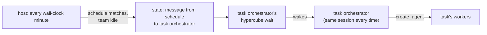

# Scheduled tasks

## Goal

The default team's orchestrator creates, changes, lists, and deletes scheduled
tasks through MCP tools. A task has a name, a cron schedule, a prompt, and the
profile its orchestrator runs with. Each task owns a team named after it, as
described in `2026-10-28-004-teams.md`. Its orchestrator, the task
orchestrator, keeps one persistent harness session: every time the task fires,
its prompt reaches that session as a message, the way any message wakes an
idle agent. The task orchestrator can create workers, which join the task's
team. The header shows how many tasks the workspace has and how many are
running. The team list shows the task teams under "Scheduled", and the
workspace overlay shows each workspace's task counts.

## Overview

A task is a team with a schedule. A firing is a turn in the task
orchestrator's session, not a new team. Workers it creates stay until it
removes them. Like every team, a task's team runs all the time, and the user
views it through the team list.

## Related code

- `src/store.rs`: `Agent::team`, `DEFAULT_TEAM`, `State::teams`,
  `State::team_orchestrator`, `State::root`, `State::remove`, `State::take`,
  `EXITED`, `ago`.
- `src/mcp.rs`: `tools`, `Server::call`, `create_agent` (with its rollback),
  `remove_agent`, `list_agents`, `orchestrator`, `valid_name`.
- `src/hook.rs`: `facts`, `format` (how a message reaches the model).
- `src/host.rs`: `create_team`, `delete_team`, `launch`, `serve` (the loop's
  deadlines and events), `read_bar`, `TeamChrome::draw`, and the control
  requests the MCP server sends.
- `src/teamlist.rs`: `TeamList` rows, keys, and drawing.
- `src/overlay.rs`: the workspace overlay's rows and columns.
- `src/bin/hypercube-test-harness.rs` and `tests/integration.rs`: the
  stand-in calls MCP tools on command; the teams test is the pattern for the
  new integration test.

## Decisions

- **Tasks and teams.** `State::tasks: Vec<Task>`, loaded with
  `null_as_default`. `Task { name, schedule, prompt, last_run }`, where
  `last_run` is Unix seconds of the last firing, 0 for never. A task's team
  is the team named `name`, and its orchestrator is
  `State::team_orchestrator(name)`. `State::task(name)` finds a task. A team
  with a task is a task team; the others are plain teams.
- **The task orchestrator.** Named after the task, as every non-default
  team's orchestrator is named after its team, so the default orchestrator
  can `send_message` it by the task's name, which is also how to run a task
  now. It runs with the harness, model, and effort of the profile
  `create_task` names, saved on the agent as a worker's are, so a session
  restart keeps them and later changes to `config.json` do not. The profile
  is fixed for the task's life. Otherwise it is a team orchestrator like any
  other: in the checkout on the checkout's branch, idle with an empty prompt
  at launch, resuming its saved session, and given a failed pane when its
  launch fails.
- **The shared checkout.** A task orchestrator's facts tell it not to merge,
  commit, or change files in the checkout. Work that changes files goes to
  workers with worktrees, and it sends their branches to the default
  orchestrator with `send_message`, which integrates them. It may do
  read-only work itself in the checkout.
- **Cron schedule.** Five fields, minute hour day-of-month month day-of-week,
  in local time. Each field takes `*`, a number, `a-b`, `*/s`, `a-b/s`, and
  comma lists of these. Day-of-week is 0–7 with 0 and 7 Sunday. When both day
  fields are restricted, a day matching either matches, as in cron. No names
  (`mon`, `jan`) and no `@hourly` forms. `schedule::Schedule::parse` validates
  it at `create_task` and `update_task`; the host parses it again when it
  checks, skipping a task whose schedule no longer parses.
- **Firing.** The host checks the tasks once per wall-clock minute, waking
  for the next minute boundary in `serve`, and keeps the last minute it
  checked in memory. `schedule::fire(state, at, now)` runs inside one
  `store::update`: for each task whose schedule matches the local minute
  `at`, it queues a message from `store::SCHEDULE` (`"schedule"`) with the
  task's prompt to the task orchestrator and sets `last_run`, unless the
  task is running or a message from `SCHEDULE` is still queued for it. The
  host starts with the current minute as checked, so the minute it starts in
  is never evaluated and a restart cannot fire a task twice in one minute.
  Minutes the host was not running are not made up.
- **Tasks need an attached host.** Tasks fire only while the workspace's
  host runs, and its agents launch only once a terminal has attached to it.
  A firing before then waits in the queue. A failed task orchestrator
  likewise keeps at most one queued firing.
- **Running and failed.** A task is running while any agent of its team is
  busy, so a task orchestrator waiting on a busy worker keeps its task
  running and its next firings skipped. An exited worker does not count as
  busy. A task is failed while its orchestrator is `EXITED`. The team list
  uses the same rules for every team.
- **The schedule's messages.** `hook::format` writes a message whose sender is
  no agent as `Message from <from>:` and its text, so a firing reads
  `Message from schedule:` followed by the prompt. `send_message` cannot send
  to `schedule`, since it is no agent.
- **Tools.** Every agent's tool list gains four tools, which only the default
  team's orchestrator may call:
  - `create_task(name, schedule, prompt, profile)`: all four required. The
    `profile` schema is the enum of profile names, as in `create_agent`'s,
    and its description tells the agent to use the profile the user names
    and otherwise to choose one suited to the task from the profiles'
    descriptions, harnesses, models, and efforts. It validates the name as
    a new team's name is validated, the schedule, and the profile against
    the current `config.json`. In one update it adds the task and its
    orchestrator with `team` set to the name, then asks the host to launch
    the orchestrator. A failed launch rolls back as in `create_agent`: close
    the pane, then forget the agent and the task.
  - `update_task(name, schedule?, prompt?)`: changes the given fields. It
    takes no profile.
  - `list_tasks()`: each task's name, schedule, prompt, whether it is
    running, idle, or failed, its last run (`store::ago`, or "never"), its
    orchestrator's harness, model, and effort, and its agents.
  - `delete_task(name)`: deletes the task's team as the team list's x does,
    with the same refusals and the same recheck for workers, and removes the
    task in the update that removes its orchestrator.

  `create_agent`, `remove_agent`, and `list_agents` keep their team scopes
  from the teams plan, except that the default team's orchestrator may also
  remove a task team's worker, so it can clean up after a failed task
  orchestrator.
- **Deleting a task team from the team list.** x on a task team deletes the
  task too, through the same path as `delete_task`.
- **Facts.** The default orchestrator's facts describe the task tools and
  list the tasks with their schedules. A task orchestrator's facts say it
  runs the named task on its schedule, that each firing arrives as a message
  from schedule with the task's prompt in this same session, the shared
  checkout rule above, that the default orchestrator is reachable with
  `send_message`, and that the user sees its session only when they view its
  team.
- **Header.** While the workspace has tasks, the right text starts with
  `<clock> N task(s), M running`, followed by ` · ` and the teams' waiting
  entries when there are any. `read_bar` counts the tasks and the running
  ones from the state it already loads.
- **Team list.** The plain teams come first, in `State::teams()` order. When
  the workspace has tasks, a blank row and a dim ` Scheduled` row follow,
  then one row per task team in creation order with its name, schedule,
  agent count, and last run, the columns aligned. Up/Down and k/j skip the
  blank and section rows. n creates a plain team.
- **Workspace overlay.** While a workspace has tasks, a column after its
  agent counts reads `<clock> N task(s), M running`. Rows without tasks
  leave it blank, keeping the last active column aligned.

## Test plan

- `schedule`: parsing accepts every field form and rejects out-of-range
  numbers, empty fields, zero steps, reversed ranges, and the wrong field
  count; matching covers steps, ranges, lists, Sunday as 0 and 7, and the
  either-day rule when both day fields are restricted.
- `schedule::fire`: a matching idle task queues one message from `schedule`
  with its prompt to its orchestrator and sets `last_run`; it skips a task
  with a busy worker, a task whose firing is still queued, and a task whose
  schedule does not match or does not parse; a task whose only busy-marked
  worker is exited still fires.
- `host`: the minute the host starts in is not fired.
- `store`: a state without `tasks` loads; `task` finds a task by name.
- `mcp`: `create_task` rejects a bad name, a taken team or agent name, a bad
  schedule, a missing or unknown profile, and a caller other than the default
  orchestrator, changing nothing; its `profile` schema is the enum of profile
  names; it launches the task orchestrator in the checkout in the task's team
  with the profile's harness, model, and effort; it rolls back the agent and
  task when the host refuses. `update_task` changes only the given fields.
  `delete_task` refuses while workers remain, keeps the task when a worker
  appears between its check and its update, and otherwise removes the task,
  agent, and messages. The default orchestrator removes a task team's
  worker. `list_tasks` reports running, idle, and failed as the scheduler
  sees them, and the last run.
- `hook`: a task orchestrator's facts name its task and the shared checkout
  rule; the default orchestrator's facts list the tasks; `format` writes a
  message from `schedule` as `Message from schedule:`.
- `host` chrome: the header shows the task counts before the waiting teams.
- `teamlist`: the Scheduled section shows only with tasks; keys skip the
  blank and section rows; task rows show the schedule and last run aligned;
  x on a task team deletes the task.
- `overlay`: the task column shows only for workspaces with tasks.
- Integration: the default orchestrator's stand-in calls `create_task`; the
  header shows `1 task, 0 running`; the team list shows the task under
  Scheduled, and viewing it shows the task orchestrator's pane alone; its
  stand-in's `create_agent` adds a worker shown only in the task's view;
  after the worker is removed, `delete_task` removes the task and its team,
  and the header drops the counts.

## Implementation plan

1. `src/store.rs`: `Task`, `State::tasks`, `State::task`, `SCHEDULE`, and a
   team's running and failed state shared by the scheduler, the team list,
   and `list_tasks`.
2. `src/schedule.rs` (new): `Schedule::parse`, `Schedule::matches`,
   `LocalMinute` and `LocalMinute::now` through `libc::localtime_r`, and
   `fire`. Declare it in `src/lib.rs`.
3. `src/hook.rs`: `format` for senders that are no agent; the default
   orchestrator's task facts and the task orchestrator's guidance.
4. `src/mcp.rs`: the four task tools, their schemas and descriptions, and the
   default orchestrator's removal of task teams' workers.
5. `src/host.rs`: the minute check and `fire_tasks` in `serve`; the shared
   deletion path for `delete_task` and the team list's x; the header's task
   counts.
6. `src/teamlist.rs`: the Scheduled section and task rows.
7. `src/overlay.rs`: the task column.
8. `src/icons.rs`: `TASKS` (nf-fa-clock_o).
9. `tests/integration.rs`: the scheduled task test above.

## Documentation updates

- `docs/architecture.md`: a "Scheduled tasks" section (task teams, firing,
  running and failed, the schedule's messages, the four tools); the state
  file's tasks; the header's task counts; the team list's Scheduled section;
  the overlay's task column.
- `docs/configuration.md`: profiles are given to workers and to task
  orchestrators, and `create_task` takes one as `profile`.
- `AGENTS.md`: `src/schedule.rs` in the layout, and tasks in the integration
  tests' description.
