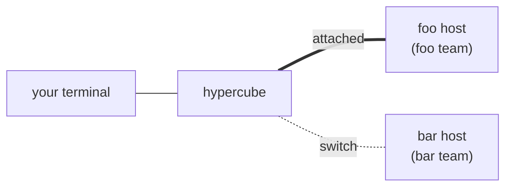
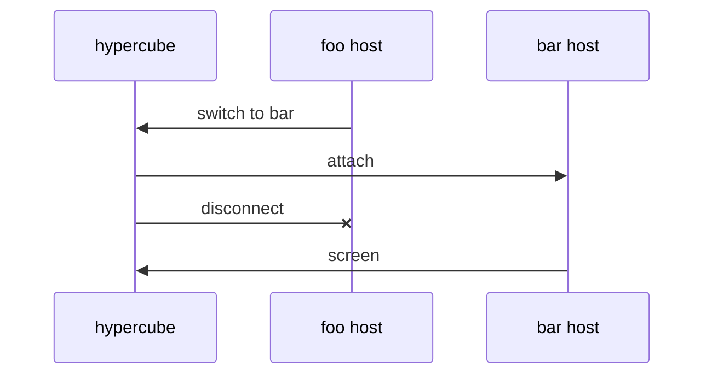

# Architecture

## Processes

- `hypercube`, run in a checkout, is the client. It runs in the user's
  terminal and attaches it to the workspace's host, starting the host if none
  is running. While no workspace is running at all, it shows the splash, where
  the user starts a workspace.
- `hypercube host <dir>` is the host of the workspace whose checkout is
  `<dir>`. It runs in the background, in its own session, from when a client
  starts it until the session ends, owns every agent's pty and pane and
  the control socket, and fires the scheduled tasks. The client or `hypercube start` starts it; it is not
  listed in the usage.
- `hypercube mcp` is each agent's MCP server, started by its harness. It
  changes the state file and worktrees itself, reads the profiles from
  `config.json`, and asks the host to launch and close panes.
- `hypercube hook <event>` runs for each harness hook event. It changes the
  state file, and reads `config.json` for the orchestrator's profiles.
- `hypercube wait` runs in the background of each agent's harness and wakes
  the agent when messages arrive while it is idle.
- `hypercube statusline` prints Claude Code's status line from the status
  JSON on its input.
- `hypercube stop`, `status`, `delete`, `start`, and `running` are
  short-lived commands. `stop` and `delete` act on the workspace of the
  working directory, of a directory argument, or, with `--all`, of every
  workspace. The argument may be a checkout that was moved or deleted;
  `delete` then removes only the workspace's files, since its worktrees and
  branches went with the checkout. `start <dir>` starts the host of the
  workspace containing `<dir>` in the background unless one is running, and
  returns once it listens; its agents launch when a terminal first attaches.
  `running` prints the directory of every running workspace, one per line,
  in the bar's order.

Each agent's harness runs with `HYPERCUBE_AGENT_ID` and `HYPERCUBE_STATE`, the
agent's ID and its workspace's state file, which the MCP server and the hooks
read to find their agent.

A workspace is named from its checkout path (`workspace::name`): the
directory's name and the start of a hash of the path. Outside Git, the
workspace is the directory itself. The name keys every file of the workspace
in the state directory, `$XDG_STATE_HOME/hypercube` or
`~/.local/state/hypercube`:

- `<name>.json`: the state file.
- `<name>.lock`: the state file's lock.
- `<name>.host.lock`: the host lock, holding the host's process ID.
- `<name>.log`: the output of the workspace's hosts, appended.
- `<hash>.sock`: the control socket, named from a hash of the workspace name
  so its path stays within the 104 bytes macOS allows.

The state directory also holds `opencode-plugin/index.js`.

## The host

`host::serve_workspace` hosts a workspace:

1. It takes an exclusive, non-blocking `flock` on the host lock and writes its
   process ID into the file. A workspace is running while that lock is held,
   and the kernel releases it however the host ends. If another host holds
   it, the new host exits with an error.
2. It readies the state: on the first run it creates the default team's
   orchestrator; it puts agents without a team in the default team, sets
   `no_git` outside Git, sets the orchestrators' branch, marks them idle,
   and marks the workers busy.
3. It removes a socket file left by an earlier host and listens on the
   control socket. It ignores SIGHUP and ends on SIGINT and SIGTERM.
4. On the first attach, which supplies the terminal's size and its replies to
   the color queries, it launches each agent in its own pane, the
   orchestrators first. Saved sessions resume, and workers start with the
   prompt `Check your Hypercube messages.`, so they pick up messages queued
   while they were down. If the default team's orchestrator fails to launch,
   the session ends with the error. Any other agent that fails to launch gets
   a pane without a program, with the failure icon and the error in its label
   and the error in the pane, marked exited with status 127 so the focus
   skips it, and keeps it until it is removed. Agents that don't fit in the
   terminal still launch; their panes are hidden until it grows.
5. It serves until the session ends.

The loop is single-threaded: `Runtime::wait` polls the panes, the attached
client's link, the listener, the accepted connections, and a pipe that SIGINT
and SIGTERM write to. Connections are non-blocking; a request is carried out
once its line has arrived, and a connection that sends no complete request
within five seconds is dropped, so no client can stall the panes.

One client is attached at a time. An attach sends the current client
`Detached("attached in another terminal")` and lets it go. When the attached
client goes away, the host drops its attachment and the team keeps running:
the panes keep their terminals, scrollback, sizes, and holds, and the host
keeps relaunching agents. The host keeps the color replies of the most recent
attach, so a harness relaunched while no client is attached still gets
answers.

The session ends on a `stop` request, the overlay's stop key for the host's
own workspace, a signal, or when the host panics. The host then sends the
client `Detached("stopped")`, or the error that ended it, removes every pane,
which sends SIGHUP to each program's process group, gives the programs up to
`HANGUP_GRACE_MS` (two seconds) before SIGKILL, removes the socket, and
releases the host lock. The next `hypercube` resumes the agents from their
saved sessions and the queued messages.

## The client

`client::run` attaches the user's terminal to a workspace. It requires a
terminal on its input and output. It puts the terminal in raw mode on the
alternate screen, asks it once for its default colors, its 16 palette colors,
and its grapheme clustering mode, and watches SIGWINCH through `signals`.
It is the only process that changes the terminal's settings or writes to it;
hosts send it rendered bytes.

To reach a workspace's host, the client sends `attach` on its control socket.
If no host is running, it runs `hypercube host <dir>` with `setsid`, its input
from `/dev/null`, and its output appended to `<name>.log`, and retries every
50 ms for up to five seconds. A new host inherits the client's environment.
If the host exits first, or the time runs out, the error includes the last
lines of the log.

`client::proxy` then passes the terminal's input to the host as `Input`
messages and its new sizes as `Resize`, and writes each `Output` payload whole
to the terminal before it reads the next message, so a terminal that stops
taking output stops the client from reading the socket. On `Detached(reason)`,
the end of the terminal's input, or the end of the stream, it restores the
terminal, prints the reason if there is one, and exits with status 0.
SIGHUP, SIGINT, and SIGTERM end it the same way, including while it queries
the terminal, waits for a host's reply, or is blocked writing to a terminal
or host that takes nothing, and the host drops its attachment. After a
signal, the client restores the terminal without waiting for its output to
drain, prints nothing, and exits with status 0.

On `Switch(dir)`, the client attaches to the host of the workspace whose
checkout is `dir`, starting it if needed. On success it drops the old
connection, resets the terminal's mirrored modes, and continues with the new
host, whose first frame draws everything. Neither host stops. On failure it
sends the old host `SwitchFailed(error)`.

### Splash

While `bar::running` lists no workspace, `hypercube` with no arguments takes
the terminal as `client::run` does and calls `client::run_splash` in place of
attaching. `client::splash` draws `splash::Splash` until the user starts a
workspace, and then attaches to it as `client::run` does, or until the user
quits, which gives the terminal back and exits with status 0. A signal ends it
the same way, and a new terminal size draws everything again.

The tesseract fills every row but the last, in the shades of the first accent,
gray. The last row is the hint ` Ctrl-b c new workspace · Ctrl-b d exit` in the
bar's colors. The keys, which the client reads in their legacy form, as the
mux reads host input: a key or escape sequence cut off by the end of a read
waits for the next read, and a lone Esc or a cut-off sequence is taken as it is
after `mux::INPUT_HOLD_MS`:

- Ctrl-b c turns the last row into the bar's prompt for a workspace's path,
  starting with the working directory. The prompt takes the keys it takes in
  the host (see the bar below), and Esc closes it.
- Enter on the prompt starts the host of the workspace containing the path,
  the top of the checkout or the directory itself outside Git, and attaches to
  it. A path that is no directory shows its error in the last row for five
  seconds.
- Ctrl-b d and Ctrl-c exit, whether or not the prompt is open.

`tesseract::Tesseract` draws the tesseract as a wireframe of its 32 edges. It
turns in the XW plane at 0.5 radians a second and in the YZ plane at 0.31,
and is projected with perspective along W, then along Z. Its edges are drawn
with braille dots, two across and four down each cell, which are square on a
terminal. The size is set by the cube's widest reach over every angle, so that
it fills 95% of the smaller side of the area at its widest and does not change
size otherwise. A cell is shaded by its nearest dot's depth, in twelve steps
from the accent mixed 25% toward black, for the nearest, to the accent mixed
60% toward black. The splash draws a frame every `splash::FRAME_MS` (40 ms),
writing only the cells that differ from the last.

### Attach stream

`attach {protocol, size, replies}` carries `link::PROTOCOL`, the terminal's
size in columns, rows, and pixels, and its replies to the queries. A host of
another protocol refuses with an error telling the user to stop the workspace
and start it again; hosts are never stopped automatically. After the host
replies `{"ok":true}`, the connection carries `link::Message` values, each a
kind byte, a 4-byte big-endian length, and the payload, up to 1 MiB:

- client to host: `Input(bytes)`, `Resize(size)`, `SwitchFailed(text)`
- host to client: `Output(bytes)`, `Switch(dir)`, `Detached(reason)`

A frame over 1 MiB goes as several `Output` messages, each split just
before an Esc, so every message holds whole escape sequences.

### Relaunching

When an agent's program exits, the host starts its harness again in the same
pane, resuming the saved session as at startup: `harness::command` with the
agent's session ID and a worker's prompt. The host first marks the
agent idle (orchestrator) or busy (worker) in the state, so the new harness's
hooks change it afterwards. The pane keeps its place, its size, and its focus.
It gets a new terminal, so nothing the old program left half written carries
over, the old program's process group is hung up, and the host input aimed at
the old program is dropped: a selection, a mouse press in progress, held input,
and the rest of a paste.

A program that exits within `QUICK_EXIT_MS` (ten seconds) of starting has
exited quickly. After `MAX_QUICK_EXITS` (three) quick exits in a row the host
leaves the pane showing its exit status N and gives up its focus, until `remove_agent`
closes it. An exit after a longer run resets the count. A relaunch whose
harness fails to start shows the failure as a worker's failed launch does, and
is not retried.

When the host gives up on an agent this way, or a worker fails to launch at
startup, it marks the agent `exited` in the state, so `list_agents` shows it
and `send_message` to it says the agent is not running. Its messages stay
queued; the next session's start marks it idle or busy again.

The host keeps running when every agent has been left exited. Closing an
agent and ending the session hang up the programs without relaunching them.

### Layout and chrome

The first row is the header and the last is the bar. The panes go between
them. `host::layout` reserves one column for the divider and gives the
orchestrator its share of the remaining columns, half to start with, rounded
down, with the workers stacked in the rest. Alone, the orchestrator has all the
columns and no divider. Every pane has a label row above its
content, and every expanded worker at least one row; the rows left go to the
expanded workers by weight, equal to start with. A collapsed worker keeps its
label row and gets no rows, so the next label sits right below it; its pane
is hidden. A layout in which some pane would get no row or column fails; a
launch requested on the control socket then fails with "no room for another
pane", and a terminal resized below that hides the panes until it grows.

Dragging the divider sets the orchestrator's share of the columns to where
the pointer is. Dragging a worker's label row moves it up or down, resizing
the nearest expanded workers above and below it, each keeping a row; every
expanded worker's weight becomes its rows beyond the first, so the layout
gives them back exactly at this size and scales them when the terminal
resizes. A new worker takes the average weight of the expanded workers. The
shares, weights, and collapsed workers last as long as the host.

`host::zoom_layout` gives one pane the whole area, keeping its label row,
and hides the others. A hidden pane has an empty rectangle: it is not drawn,
takes no mouse input (a press it had captured ends there), and keeps its
size, so its program sees no resize. The host zooms the focused pane on
Ctrl-b z. It restores the normal layout when the key is pressed again, when
the focus changes, when a pane is added to the viewed team, and once a closed
pane of the viewed team has melted away. The host resizing keeps the zoom.

`TeamChrome` draws in the workspace's palette, which `colors::Palette`
shades from one accent color: the accent itself for the divider and the
titles' lines, the accent mixed 40% toward white for the agents' names and
details, and for the header, the bar, and the title rows of the overlay and
the list of keys, the accent mixed 85% toward white on the accent mixed 78%
toward black, and for the overlay's selected row, the same text on the accent
mixed 55% toward black. The accent is one of the nine in `colors::ACCENTS`,
numbered by the state's `accent` field. A new workspace takes gray, the first
of them. `ACCENTS` runs gray, blue, teal, green, amber, orange, red, pink, and
purple. Ctrl-b a moves the workspace to the next one, wrapping around, writes
it to the state, and redraws.

Four colors in `colors.rs` keep one meaning wherever they are drawn:
`ATTENTION`, amber, for an agent, team, or workspace waiting for a tool
approval; `ERROR`, red, for a harness that failed to start, a program that
exited, or a team whose orchestrator exited; `RUNNING`, green, for a running
workspace, busy team, or busy agent; and `QUIET`, gray, for a stopped workspace,
idle team, or idle agent.

The chrome, the bar, and the overlay draw Nerd Font icons, all of them in
`icons.rs`, each followed by a space. `TeamChrome` draws:

- The header across the first row: one space, the open folder icon, and the
  workspace's directory, with the home directory written as `~`, clipped to
  fit. While the workspace has more than one team, ` › ` and the viewed
  team's name follow. At the right end, followed by one space, while the
  workspace has scheduled tasks, the clock icon, `TASKS`, and
  `N task(s), M running`, then each other team with an agent waiting for a
  tool approval as its name and an `ATTENTION` bell, in `State::teams` order,
  all joined by ` · `. The host reads the counts with the attention flags.
  The right text is dropped when it doesn't fit beside the left text.
- Each agent's label row across its pane's full width. The left end has one
  space, for a worker beside the divider a chevron and a space, pointing down
  while expanded and right while collapsed, and the agent's name, bold for
  the focused pane, followed by an activity dot in `RUNNING` while the agent
  is busy and `QUIET` while it is idle, only if the dot fits and the pane's
  program has not exited. An `ATTENTION` bell follows while the agent waits
  for a tool approval, only if the bell fits. Then come the expand icon while
  the pane fills the area, the exit icon and the status once the pane's
  program has exited and is not relaunched, the warning icon and the error
  for an agent whose harness did not start, both in `ERROR`, and "↑N" while
  its view is scrolled N rows up. Each note after the name follows ` · `.
  The right end has, followed by one
  space, the branch icon and the branch (without its `hypercube/` prefix for
  a worker), or the folder icon and the directory with the home directory
  written as `~` for agents without a branch. A row too narrow for the right text drops it,
  keeping a blank column after the left text, and then clips the left text
  at a grapheme cluster. The row is a heavy line (`━`) with a space on each
  side of the text and a column of line at each end.
- The divider: a heavy `┃` right of the orchestrator, down every row between
  the header and the bar, with a `┳` where the top titles meet and a `┣` on
  each lower worker's label row. A zoomed pane has no divider, and neither
  does a lone orchestrator, which has only its label row.

`bar::Bar` draws the last row in the header's colors. It lists every running
workspace, numbered from 0 in the order its host started (the modification
time of its host lock), with one leading space and ` · ` between tabs:
` 0 foo · 1 bar · 2 glarpy`. Each tab has the name of its checkout's directory
after its number. All tabs share the bar's background: the current workspace's
text is the bar's foreground and bold, other tabs' text is mixed 40% toward
the background, and separators are mixed 55% toward the background and not
bold. An `ATTENTION` bell follows the name while an agent of the
workspace waits for a tool approval, until the approval is answered (see
[harness support](harness-support.md)). It shows as many as fit, whole. A click
on tab text switches to that workspace, as Ctrl-b and its number do; clicks on
the leading space or separators do nothing. The host reads the list, the
current agents' activity, the agents' and teams' attention flags, and the
orchestrators' branch on each attach and every second while a client is
attached, redrawing when any changes.
It reads the checkout's `HEAD` file rather than spawning Git; a detached
HEAD drops the branch detail in favor of the directory. Ctrl-b and a digit
switch the client to the workspace with that number, as the overlay's Enter
does; on the host's own workspace they close the overlay if it is open. A failed switch shows its
error in the bar for five seconds, or in the overlay while it is open.

Ctrl-b c closes the overlay if it is open and turns the bar into a prompt,
`workspace path: ` and the path typed so far with a reverse-video cursor
after it, showing the end of a path too long to fit. Input is captured while
it is open: text goes at the end of the path, Backspace erases its last
character, Esc closes the prompt, and Enter closes it and switches the
client to the workspace containing the path, as `hypercube` run there would
attach: `~/` is the home directory, a relative path is relative to this
workspace's root, and the workspace is the top of the checkout containing
it, or the directory itself outside Git. The client starts that workspace's
host if none is running. On the host's own workspace Enter just closes the
prompt, and a path that is no directory shows its error in the bar.

The keys and the mouse (see Input):

- A click focuses the pane under the pointer, and a click on a workspace's
  tab in the bar switches to it. A click on a worker's arrow collapses or
  expands it.
- Dragging the divider or a lower worker's label row resizes the panes.
- The wheel scrolls the pane under the pointer, unless its program reports
  the mouse.
- Shift-PageUp, Ctrl-b [, and Ctrl-b PageUp scroll the focused pane up a
  page. While it is scrolled,
  PageUp, PageDown, Up, and Down scroll it, Esc and q return it to the
  bottom, and any other key returns it to the bottom and goes to its
  program.
- A drag selects text and copies it to the clipboard on release.
- Ctrl-b is a prefix, in legacy or Kitty form, with tmux's keys. The next
  key press goes with it:
  - o moves the focus to the next live pane.
  - z zooms the focused pane, or restores the layout.
  - [ and PageUp scroll the focused pane up a page.
  - s opens the workspace overlay, or closes it.
  - t opens the team list, or closes it.
  - a digit switches to the workspace with that number in the bar.
  - ( and ) switch to the previous and next workspace in the bar, wrapping
    around.
  - c prompts for the path of a workspace to switch to.
  - d detaches the client.
  - a gives the workspace the next accent color.
  - ? lists the keys over the whole screen, as the overlay is drawn, until
    the next key.
  - Ctrl-b sends Ctrl-b to the focused pane.
  - Any other key is dropped.

  Mouse and focus reports, pastes, key releases and repeats, and modifier
  keys go on as usual and leave the prefix waiting. A Kitty key with Shift is
  taken as its shifted key, or without one reported, as the character Shift
  gives it on a US keyboard. The prefix works while the overlay, the list of
  keys, the team list, or the prompt is open too, where o, z, [, PageUp, and
  Ctrl-b do nothing. The overlay, the list of keys, the team list, and the
  prompt each close the others.

Labels are clipped to whole grapheme clusters, measured in
columns.

### Workspace overlay

Ctrl-b s opens the overlay. While it is open, the host lays every pane out
hidden, so the panes keep their sizes, and `TeamChrome` draws the overlay across the
whole screen: a title row, a row for each workspace with a state file, most
recently active first, and the keys in the last row. Each workspace row starts
with a play icon in `RUNNING` while the workspace runs, or a stop icon in
`QUIET` while it is stopped, then shows its directory, bold for the host's own
workspace, its number of agents and of busy agents, and its last activity.
While any workspace has scheduled tasks, a column between the agent counts
and the last activity shows the clock icon and `N task(s), M running` for
each workspace with tasks, and is blank for the others, so the last activity
stays aligned. The
selected row is drawn in the palette's selection colors. The list is
read again every second while the overlay is open.

The mux captures input while the overlay is open (see Input). The keys:

- Up and Down, or k and j, move the selection, stopping at the ends.
- Enter switches the client to the selected workspace, starting its host if
  it is stopped. On the host's own workspace, it closes the overlay. The host
  sends the client `Switch(dir)` and keeps the overlay open until the client
  leaves or reports that the switch failed.
- x stops the selected running workspace. Another workspace is stopped on a
  thread, so the host keeps serving while it waits, and the list shows the
  result when it is done. Stopping the host's own workspace ends the session,
  and the client exits with "stopped".
- d detaches the client.
- Esc or Ctrl-b s closes the overlay.

A failed switch or stop shows its error in the last row until the next key.

### Teams

A workspace holds one or more teams. Each agent's `team` field names its
team. A team is its orchestrator, the agent with role `orchestrator` and that
team, and the workers whose `team` matches. Every workspace has the team
`default`, whose orchestrator is named `orchestrator` and is created on the
first run. Every other team's orchestrator has the team's name. A team's name
is lowercase letters, digits, and hyphens, and no other team or agent has it.
Every orchestrator runs in the checkout, on the checkout's branch, so the
teams share the checkout. A task's orchestrator runs with the harness,
model, and effort of the profile its task was created with (see Scheduled
tasks), and every other orchestrator with `config.orchestrator`'s. `State::teams` lists the teams in the order of their orchestrators:
`default` first, then the others in the order they were created.

The tools act within the caller's team. `create_agent` puts the new worker in
the calling orchestrator's team, `remove_agent` removes only workers of the
caller's team, except that the default team's orchestrator also removes the
workers of a task's team, and `list_agents` lists the caller's team. `send_message`
reaches any agent in the workspace. SessionStart lists the agent's own team,
and while the workspace has other teams, an orchestrator's also names each
other team's orchestrator with its ID. Worker names are unique across the
workspace, since worktrees and branches are named after workers.

The host shows one team at a time, the viewed team, and starts every session
viewing `default`. Every other team's agents keep running in background panes:
the host lays each team out as `host::layout` would place it if it were
viewed, at the terminal's size, so its programs run at the size they will be
shown at, then hides its panes. A background pane is never focused: Ctrl-b
o, a melt, and an exit move the focus only among the viewed team's panes.
Bells and notifications from background panes still reach the terminal.
Viewing a team ends any zoom, puts every other team's panes in the
background, focuses the team's first live pane, and lays the panes out. The
divider's split is shared by all teams, and the workers' weights and
collapsed state are each team's own. A team with only its orchestrator lays
out as a lone orchestrator does.

Ctrl-b t opens the team list, drawn across the whole screen in the overlay's
style: a title row, ` Teams`, a row for each team, and the keys in the last
row. The teams without a scheduled task come first, in `State::teams` order.
While the workspace has tasks, a blank row and a dim ` Scheduled` row follow,
then a row for each task's team in the order the tasks were created, with
its schedule, its number of agents, and how long ago it last fired, or
`never`, in aligned columns. Each row starts with the team's state icon: the play icon in `RUNNING`
while any of its agents is busy, the warning icon in `ERROR` while its
orchestrator is `exited`, and the pause icon in `QUIET` otherwise. The name
follows, bold for the viewed team, then the number of its agents, and an
`ATTENTION` bell while one of them waits for a tool approval. The list opens
with the viewed team selected, and is read again every second while it is
open. The mux captures input while it is open. The keys:

- Up and Down, or k and j, move the selection among the teams, stopping at
  the ends.
- Enter views the selected team and closes the list.
- n opens the prompt ` New team: ` in the last row. While it is open, typed
  characters build the name, Backspace erases the last one, Esc closes the
  prompt, and Enter creates the team.
- x deletes the selected team, and a task's team's task with it.
- Esc or Ctrl-b t closes the list.

Creating a team adds its orchestrator to the state, launches it with an empty
prompt, views the team, and closes the list. If the launch fails, the
orchestrator is removed again. Deleting a team refuses the default team and a
team with workers, naming them. Otherwise it closes the orchestrator's pane,
then removes the orchestrator, its queued messages, and the team's task, if
it has one, unless the team gained a worker meanwhile, in which case the
orchestrator stays, without a pane, until the workers are removed and the
team is deleted again. Deleting the viewed team views `default`, as does the
closing of the viewed team's last pane. The orchestrator's harness session stays where
the harness keeps it. A failure shows in the last row until the next key.

### Scheduled tasks

A scheduled task (`store::Task`) has a name, a schedule, a prompt, and the
Unix time it last fired, `last_run`, 0 before its first firing. Each task
owns the team of its name, a task's team, whose orchestrator, the task's
orchestrator, has the task's name too. The default team's orchestrator can
therefore `send_message` it by the task's name, which also runs the task at
once. A task's orchestrator keeps one harness session: every firing reaches
that session as a message. Until the session is saved, the host and
`create_task` launch the orchestrator busy with the start prompt
`control::TASK_START`, whose turn creates the session, saves its ID through
UserPromptSubmit, and ends in a waiter, which a new OpenCode session has only
from its first prompt. Once saved, it resumes idle without a prompt. Its workers join its team and stay until it
removes them. Like every team, a task's team runs all the time.

A schedule is five cron fields in local time: minute, hour, day-of-month,
month, and day-of-week. Each field is `*`, a number, `a-b`, `*/s`, `a-b/s`, or
a comma list of these. Day-of-week runs from 0 to 7, with 0 and 7 both
Sunday. When neither day field starts with `*`, a day matching either
matches. `schedule::Schedule` parses and matches schedules.

The host checks the tasks once a minute of the wall clock, waking at each
minute's start. It starts with the minute it starts in as checked, so that
minute is never checked and a restart cannot fire a task twice in one minute,
and it does not make up minutes it did not run in. `schedule::fire` runs in
one state update: each task whose schedule matches the minute gets a message
from `schedule` with its prompt, queued for its orchestrator, and its
`last_run` set. A task is skipped while it is running, while a message from
`schedule` is still queued for its orchestrator, and while its schedule does
not parse. A task is running while any agent of its team is busy, and failed
while its orchestrator is `exited`. Tasks fire only while the host runs, and
their orchestrators launch only once a terminal has attached, so a firing
before then waits in the queue, as it does for a failed orchestrator.

The default team's orchestrator has four tools for tasks, which no other
agent may call:

- `create_task(name, schedule, prompt, profile)` checks the schedule and the
  profile against `config.json`, then in one update adds the task and its
  orchestrator, with the profile's harness, model, and effort, refusing a
  name as a new team's is refused. It launches the orchestrator with the
  start prompt. If the launch fails, it closes the pane and removes the
  orchestrator and the task as `remove_team` does, keeping both, with an
  error naming the workers, if the orchestrator created workers before its
  pane closed. The `profile` schema is the enum of the
  profile names, and its description asks for the profile the user names,
  or else one suited to the task.
- `update_task(name, schedule?, prompt?)` changes the given fields.
- `list_tasks()` lists each task's name, schedule, prompt, state (running,
  failed, or idle), last run, its orchestrator's harness, model, and effort,
  and its team's agents.
- `delete_task(name)` deletes the task's team as the team list's x does,
  with the same refusals and the same check for a worker created meanwhile,
  and removes the task in the update that removes its orchestrator.

The default team's orchestrator's SessionStart describes the task tools and
lists the tasks with their schedules. A task's orchestrator's names its task
and schedule, says that each firing arrives in its session as a message from
`schedule`, that it leaves the checkout's files, commits, and merges to the
default team's orchestrator, doing only read-only work there and giving work
that changes files to workers with worktrees, whose branches it sends to the
default team's orchestrator, and that the user sees its session only when
viewing its team.

## Control socket

Each connection carries one JSON request line and gets one JSON reply line,
`{"ok":true}` or `{"ok":false,"error":"..."}`. Agents are named by ID.

- `launch {agent, prompt}`: load the agent from the state, build its command
  with `harness::command`, start it in a new pane, and lay the panes out
  again. A non-empty prompt starts its first turn.
- `close {agent}`: hang up the agent's program, melt its pane away over about
  a second, remove it, and lay the panes out again. A pane hidden by a zoom or
  a screen is removed at once. An agent without a pane is already closed.
- `stop`: reply, then end the session.
- `attach {protocol, size, replies}`: attach the client's terminal; the
  connection then carries the attach stream (see The client).

The MCP server and `hypercube stop` find the socket from the state file's
path. A request that finds no socket, or nothing listening on it, means no
host is running.

`launch` fails if the agent already has a pane or its team's layout has no
room for another. `launch` and `close` of an agent in the viewed team end any
zoom.

## State file

The state file holds the agents (ID, name, role, harness, model, effort,
directory, branch, team, session ID, activity, the number of the newest
waiter, and whether it waits for a tool approval), the queued messages (sender,
recipient, text), the scheduled tasks (name, schedule, prompt, last run),
`no_git`, and the accent color's number, `accent`.
Every change takes an exclusive `flock` on the state's lock, reads the file,
and writes the result to a temporary file renamed over it, so hooks, MCP
servers, and the host change it concurrently and readers always see a whole
file.

The state's lock file is created with the state and never written, so its
modification time is the workspace's creation time. An update that leaves
the state as it was writes nothing, and agents change the state as they start
and end turns and as messages are queued and delivered, so the state file's
modification time is its last activity.
`hypercube status` lists every workspace with a state file by last activity,
with its directory, whether its host lock is held, its number of agents, and
both times. A workspace's directory is its default team's orchestrator's. An
agent written without a team loads into the default team.

A worker created without a directory has the branch `hypercube/<name>` and
the worktree `<checkout>/.hypercube/<name>`, created from the orchestrator's
HEAD. `.hypercube/` is in the checkout's local Git excludes, and the directory
is removed with the last worktree. A workspace outside Git has no branches or
worktrees: each worker works in the directory `create_agent` gives it.

`hypercube delete` refuses if a worker's worktree is dirty or its branch is
not merged. Otherwise it stops the host and takes the host lock itself, so
no host starts while it works. It removes each worker's worktree and branch,
deletes the state, its lock, the socket, and the log, and removes the host
lock file last. A host that takes the host lock checks that the file it locked is still
the one at the path, and otherwise locks the current one.

`hypercube stop --all` lists the directory of every workspace whose host lock
is held, and `hypercube delete --all` lists every workspace with a state file.
Each command asks `Stop all of these? [y/N]` or `Delete all of these? [y/N]`
and continues only on `y` or `yes`; any other answer ends it with
"stop cancelled" or "delete cancelled". It then runs the single-workspace
command on each workspace in turn, with the same refusals. A workspace that
fails does not stop the rest: afterwards the command exits with an error that
lists each failure as `<directory>: <reason>`. With nothing to act on, it
prints `No workspaces to stop.` or `No workspaces to delete.`.

## Message delivery

`send_message` queues a message in the state file. Hooks deliver messages to
a busy agent:

- SessionStart gives the agent its identity, team, and tools (see Teams).
- UserPromptSubmit records the session ID, marks the agent busy, and delivers
  queued messages as context.
- PostToolUse delivers messages that arrived during the turn.
- Stop blocks the stop while messages are queued, delivering them, and
  otherwise marks the agent idle.
- StopFailure marks the agent idle and leaves its incoming messages queued.
  A worker's failed turn queues a message from the worker to its team's
  orchestrator, with a failure notice and the error text trimmed to 2,000
  characters. An orchestrator's failure queues no message. A user-interrupted
  turn sends no failure notice.

An idle agent is woken by its waiter, `hypercube wait`, which the harness
starts when a session starts and after each turn's stop. A waiter increments
the agent's waiter number and keeps the new number as its own. It reads the
state every 250 ms. When the agent is idle with messages queued, it takes
them, marks the agent busy, writes them to stderr, and exits with status 2.
The harness then starts a turn with the messages: Claude Code through its
`asyncRewake` hook, OpenCode through its plugin (see
[harness support](harness-support.md)). The harness starts the turn itself,
so text the user is typing in the agent's pane stays in the harness's editor.
A waiter exits with status 0 once the agent is gone, the agent's waiter
number has moved past its own, or the process that started it has exited.

Each message reaches the model as `Message from <name> (<id>):` and its text.
A message whose sender is no agent, such as a task's firing, reaches it as
`Message from <sender>:`, as in `Message from schedule:`.
A hook writes its response, and a waiter its messages, inside the state
update, so messages it takes stay queued if they cannot be written.
Failure notices use the same queue and delivery: a busy orchestrator receives
them through its hooks, and an idle orchestrator is woken by its waiter.

## Terminal layer

The terminal layer (`mux`, `pty`, `runtime`, `link`, `client`, and
`signals`) runs programs in ptys, keeps a Ghostty terminal for each, and draws
them for the user's terminal, which the mux calls the host terminal.
It knows nothing about agents: the caller decides where panes go, what the
chrome looks like, and what to do when something happens.

### Panes

`Mux` holds the panes. Each pane has a stable `PaneId`, a label, a Ghostty
`Terminal`, and, once a program is attached, the program's pty master and
child process.

- `Mux::add_pane(label)` adds an empty pane and focuses it if no live pane
  has the focus.
- `Pty::spawn(argv, cwd, env, size)` starts a program in its own session with
  a new pty as its controlling terminal. `TERM` is `xterm-256color` and
  `COLORTERM` is `truecolor`. The master is non-blocking and close-on-exec,
  so later programs don't inherit it. `Mux::attach(id, pty)` gives the pane
  its program.
- `Mux::set_layout(&[(PaneId, Rect)])` places panes on the host terminal,
  resizes the terminals and ptys whose size changed, and redraws the screen.
  A pane given an empty rectangle is hidden and keeps its size. The caller
  lays the panes out again after adding or removing one and after the host
  resizes.
- `Mux::close_pane(id)` sends SIGHUP to the program's process group and
  closes the master. The pane stays, and shows its exit status once reaped.
- `Mux::mark_exited(id, status)` shows a pane whose program never started
  as exited with `status`, so the focus skips it.
- `Mux::restart(id, label)` readies a pane whose program has exited for a
  new one: a new terminal of the same size, a replaced label, and the old
  program's process group hung up. It drops the host input aimed at the old
  program: the selection, a mouse press in progress, held input, and the rest
  of a paste through its end marker. The caller then attaches the new program
  with `Mux::attach`, or shows why there is none with `Mux::mark_exited`. The
  pane keeps its place, size, and focus.
- `Mux::release_focus(id)` moves the focus off a pane to the next live pane.
  A pane whose program exits keeps the focus until the caller releases it.
- `Mux::melt_pane(id)` hangs up the program if it is still running and starts
  the pane's last drawn screen melting off its bottom edge, column by column,
  over `MELT_DELAY_MS` plus `MELT_FALL_MS` (900 ms). The focus and the input
  aimed at the program leave at once, and the pane keeps its place and label
  row until `Mux::end_melts` removes it. A pane with no place on the screen is
  removed at once.
- `Mux::remove_pane(id)` hangs up the program if it is still running, removes
  the pane, moves the focus to the next live pane, and redraws the screen. A
  removed pane's program is reaped after `HANGUP_GRACE_MS` (two seconds),
  when whatever remains of its process group gets SIGKILL.
- `Mux::send_text(id, text)` types text, and `Mux::send_key(id, key)` presses
  and releases a key. Ghostty's key encoder encodes each key from the pane's
  modes and Kitty keyboard flags, so a program that asks for every key as an
  escape code gets text that way too.

Input for a pane, from the host, from `send_text` and `send_key`, and from
its terminal's replies, is queued and written as the pty takes it. A program
that stops reading its input never blocks the loop.

### Chrome

The caller draws everything around the panes through the `Chrome` trait. The
mux calls `Chrome::draw` inside a frame with a `PaneView` of each pane (ID,
label, rectangle, focus, exit status, and how many rows its view is scrolled
up) and the host size, whenever the panes, the focus, an exit status, a
scrolled view, or the host size changed. `Mux::invalidate_chrome`
asks for a redraw after a change only the caller knows about.

### Rendering

`Mux::connect_host(replies, size)` connects a host terminal: every pane's
terminal takes its color replies, and the next frame clears the screen, draws
every row and the chrome, and sets every mirrored mode, the mouse modes, the
Kitty keyboard flags, and the title, whatever an earlier connection set.
`Mux::disconnect_host()` lets it go, clearing any selection and dropping the
input in progress from it. While no host terminal is connected, `render`
draws nothing and output from outside frames is discarded.

Each pane captures the rows that changed since its last frame from a Ghostty
render state. A frame draws those rows at the pane's offset, then the focused
pane's cursor, inside synchronized output (mode 2026). A layout change, host
resize, or removed pane clears the screen and draws every row and the chrome.

A pane draws its terminal's viewport. Scrolling moves the viewport through
Ghostty's scrollback, and new output leaves a scrolled viewport where it is.
Scrolling a pane ends its hold. Selected cells are drawn in reverse video.

The focused pane's input modes are mirrored onto the host: cursor, keypad,
backspace, and Alt-key modes, reverse video, focus events, bracketed paste,
grapheme clustering, and the Kitty keyboard flags. Focus events, the window
title, and mode changes follow the focus. The host always reports mouse buttons
and drags in SGR form (modes 1002 and 1006), and motion without a button (mode
1003) while the focused pane asks for it.

Bells pass through to the host: a frame rings the bell once for any number
of bells since the last frame. The focused pane's title goes to the host in
the frame after it changes. Desktop notifications, OSC 9 and OSC 777, pass
through too: `Pane::feed` scans the program's output for them before Ghostty
sees it, keeping the scan's state between reads so a sequence split across
reads is found, and writes each one to the host terminated by BEL. OSC 9;4,
a progress report, is not a notification and does not pass through.
Notifications over 4096 bytes and sequences cut off by another control
character are dropped. Notifications and clipboard copies, the output from
outside frames, wait for the next frame only while it stays under
`MAX_SIDE_OUTPUT` (256 KiB); past that they are dropped whole.

A program that holds drawing with mode 2026 shows the last frame it
completed, captured when the hold began, including when the screen is drawn
again. Resizing a pane's terminal ends its hold. A hold that lasts
`HOLD_TIMEOUT_MS` (one second) ends as if the program had ended it.

### Input

Host input goes to the focused pane. A bracketed paste, from `ESC [ 200 ~`
through `ESC [ 201 ~`, goes as it is to the pane focused when it began. Outside
a paste, these are routed elsewhere:

- Ctrl-b, in its legacy byte or as a Kitty key press, and the key after it
  go to no pane; Kitty repeats and releases of Ctrl-b are consumed. Ctrl-b o
  moves the focus to the next live pane, Ctrl-b [ and PageUp scroll it, and
  the others are reported to the caller: z as `Event::Zoom(id)` for the
  focused pane, once per press, s as `Event::Overlay`, a digit as
  `Event::Workspace(n)`, ( and ) as `Event::Step(-1)` and `Event::Step(1)`,
  c as `Event::NewWorkspace`, d as `Event::Detach`, a as `Event::Accent`,
  ? as `Event::Help`, and t as `Event::Teams`.
- Shift-PageUp, in legacy or Kitty form, scrolls the focused pane up a page.
- While the focused pane is scrolled, PageUp and PageDown scroll it a page,
  Up and Down a row, and Esc and q return it to the bottom. Any other key
  returns it to the bottom and goes to the program. Kitty key releases are
  consumed.
- Mouse reports go to the pane under the pointer, and a left-button press
  outside every pane is `Event::Click`, which the host checks against the
  bar's tabs, the workers' arrows, the divider, and the label rows; the
  motion of that press is `Event::Drag` and reaches no pane. A button press in
  a pane focuses it, and
  that button's motion and release go to the same pane, clamped to its edges. A
  pane whose program tracks the mouse, and whose view is not scrolled, gets
  every report in its coordinates, encoded by Ghostty's mouse encoder for its
  tracking mode and format. In any other pane, the wheel scrolls three rows, or
  on the alternate screen with alternate scroll mode (1007) sends Up or Down
  three times, and a left-button drag selects text linearly through Ghostty's
  selection, from where the button was pressed to where it was released. A press
  released where it began is a click. On release, the selection's text, with
  soft wraps joined and trailing spaces trimmed, goes to the host's clipboard as
  OSC 52. The selection stays highlighted until the next press or until input is
  typed into its pane.

`Mux::set_captured(true)` captures input: each key or escape sequence is
reported as `Event::Key(bytes)` instead of routed, the prefix keys are still
reported, and pastes and mouse reports are dropped. The mux keeps which view
captures the input, `mux::Captured`: the overlay, the list of keys, the team
list, or the prompt. Ctrl-b s, ?, and t capture input for their view, or stop
while their own view is open, and Ctrl-b c captures it for the prompt, so
switching from one view to another keeps the input captured and the keys
after them in the same read go to the host or the panes in the order they
were typed; the caller sets capturing to match when it handles the event. The host then has every mirrored mode at its default and no Kitty
flags, so keys arrive in legacy form, and no cursor is drawn.

A key or escape sequence cut off by the end of a read, up to 256 bytes, waits
for the next read. After `INPUT_HOLD_MS` (25 ms) without the rest, what was held
is taken as it is: a lone Esc is the Esc key, and anything else goes to the
focused pane as typed. The runtime wakes for that deadline. A paste's end cut
off by a read waits for the next read without a deadline.

### Runtime

`Runtime::new()` starts with no client. `Runtime::connect(mux, link, replies,
size)` draws for the client at the other end of a `Link` from then on,
connecting the mux's host terminal. `Runtime::disconnect(mux)` drops the link,
and `Runtime::detach(mux, reason)` sends `Detached(reason)` and lets the link
go once it has written what it had queued.

The caller drives the loop with `Runtime::wait(mux, extra_fds, deadline)`,
which polls the link, every pane's master, and the caller's descriptors. It
feeds pane output to the terminals, routes the client's input, writes queued
pane input, ends timed-out holds, and reaps exited programs without blocking.
Before it reports an exit, it reads what the program left in its pty and
draws it.

The link is non-blocking and keeps a queue of outbound bytes, polled for
`POLLOUT` while it is not empty. A frame is rendered only when the queue is
empty and 16 ms have passed since the last. A frame is a balanced mode 2026
block of whole escape sequences, sent as one `Output` message, or split
before an Esc into several when it is over 1 MiB. Changes pile up
in the Ghostty terminals meanwhile, so a slow client gets fewer frames, and
the host never blocks on it. A link whose queue makes no progress for
`LINK_STALL_MS` (ten seconds) is disconnected.

`wait` returns when something needs the caller:

- `Event::Ready(fd)`: one of the caller's descriptors is readable.
- `Event::PaneExited(id, status)`: a pane's program exited; the status is its
  exit code, or 128 plus the signal that ended it.
- `Event::Zoom(id)` and `Event::Focus(id)`: Ctrl-b z was pressed with that
  pane focused, or the focus moved to that pane. They come in the order they
  happened.
- `Event::Overlay`, `Event::Workspace(n)`, `Event::Step(n)`,
  `Event::NewWorkspace`, `Event::Detach`, `Event::Accent`, and
  `Event::Help`: Ctrl-b and s, a digit, ( or ), c, d, a, or ?.
- `Event::Key(bytes)`: a key of captured input.
- `Event::Resized`: the client's terminal changed size.
- `Event::Message(message)`: the client sent `SwitchFailed`.
- `Event::Disconnected`: the link ended, failed, or stalled, and the runtime
  disconnected it.
- `Event::Deadline`: the deadline passed.

`mux::host_reset` returns the terminal's mirrored modes to their defaults,
with no Kitty keyboard flags, the default cursor, default attributes, and
synchronized output ended, in case a frame was cut off, on the alternate
screen; the client writes it after a switch. `mux::host_restore`
is `host_reset` and the main screen, which the client writes before it
restores the terminal's settings and exits.

Everything runs on one thread. The terminals and their callbacks share state
through `Rc` and `RefCell`.
