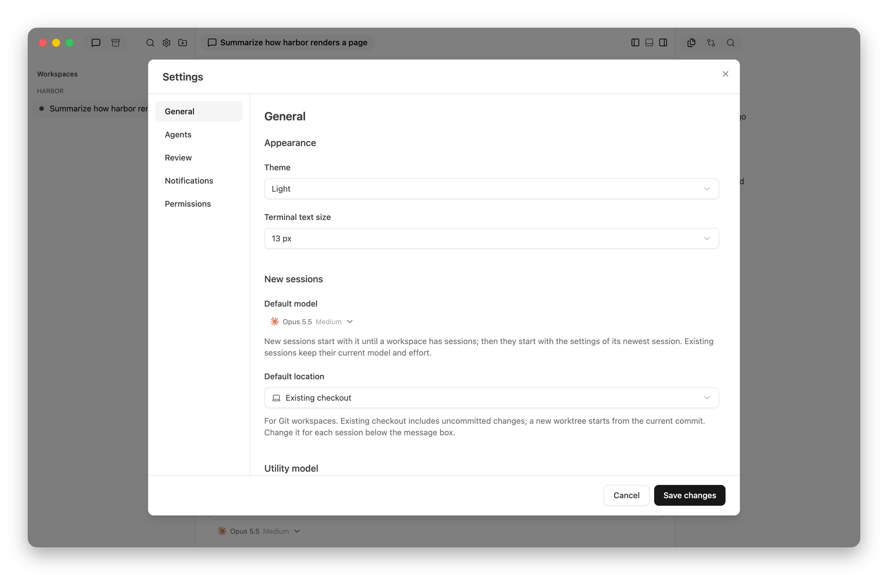
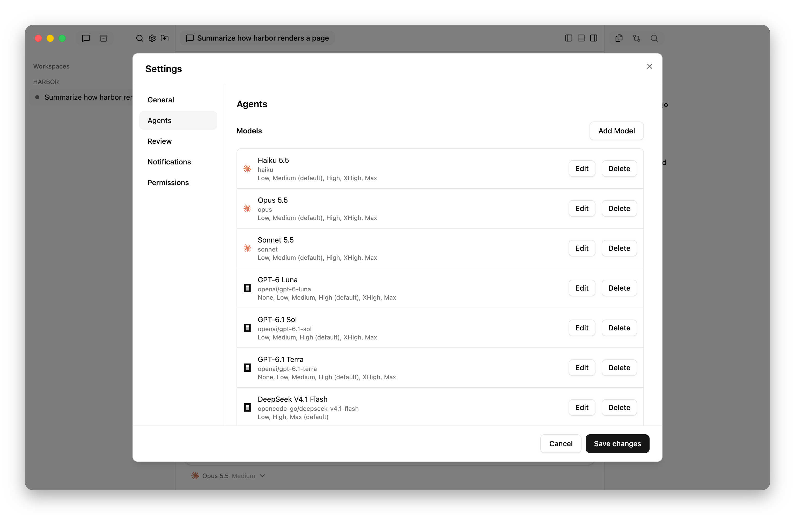
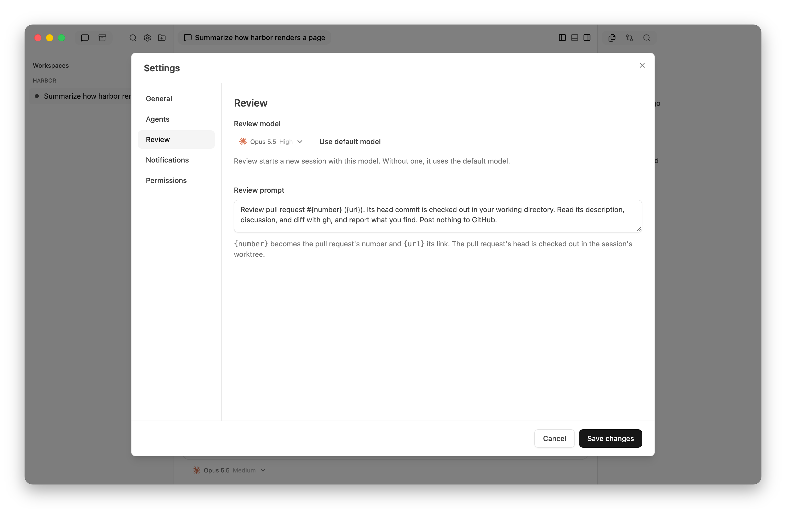
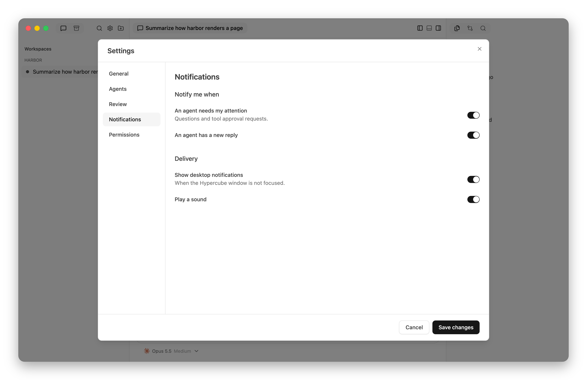
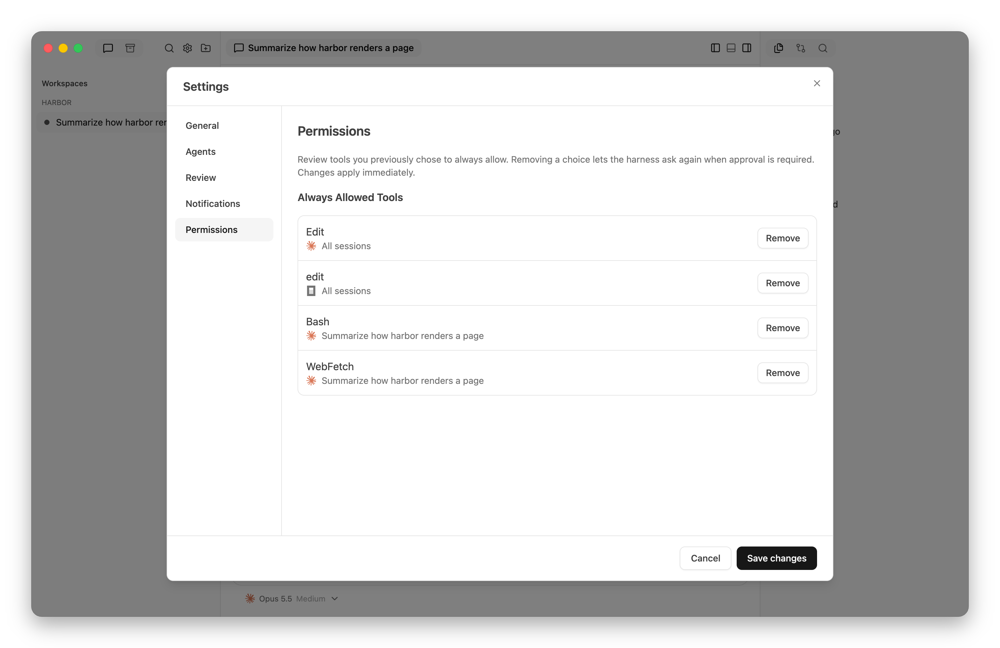

# Configuration reference

Open **Settings** with **Command+,** on macOS or **Ctrl+,** on Linux, or with
the gear button at the top of the sidebar. It opens to **General**.
**Save changes** validates and writes preferences; closing without saving
discards edits. Settings has five sections: **General**, **Agents**,
**Review**, **Notifications**, and **Permissions**.

## General

<picture>
  <source media="(prefers-color-scheme: dark)" srcset="images/settings-general-dark.png">
  
</picture>

### Appearance

- **Theme**: **System**, **Light**, or **Dark**. Defaults to **System**.
- **Terminal text size**: 12, 13, 14, 16, or 18 pixels. Defaults to 13.

### New sessions

- **Default model**: the model for the first session in a workspace. Later
  sessions start with the newest session's model. Not set by default.
- **Default location**: **Existing checkout** or **New worktree** for new Git
  sessions. The composer can override it for each session. Defaults to
  **Existing checkout**.

### Utility model

**Utility model** chooses the model that names new sessions. It is not set by
default; **Clear** removes it.

After a session's first message, the utility model reads that message, or a
child's brief, and replaces the session's title with a short one. A title you
set with **Rename** stays. Without a utility model, or when naming fails, the
title stays the start of the first message; failures appear in the service log
(`~/.local/state/hypercube/ui.log`).

Choose a model from any harness. The call runs with no tools, project
instructions, or saved conversation, in an empty temporary folder. See
[what each harness runs](harness-support.md#utility-model).

## Agents

### Models

**Models** edits the model picker list, which is empty by default. Each entry
needs a harness, its exact model ID, and a display title. Add effort levels
ordered from lowest to highest and the effort a session starts with. Leave
levels empty for a model without an effort control. One level is its own
default; several levels require a default from the list. A harness lists each
model once.

<picture>
  <source media="(prefers-color-scheme: dark)" srcset="images/settings-models-dark.png">
  
</picture>

Entries apply on **Save changes**, like other settings. Entries are checked
against the harness only when a session starts or changes model; the plugin
rejects model and effort IDs the harness does not accept. See
[harness requirements](harness-support.md#requirements).
Editing or deleting an entry does not change existing session settings or saved
defaults. Agents can still discover and choose models that are not in this
list.

### Child sessions

**Guidance for choosing child models** tells agents when a child should use a
different harness, model, or effort. It does not restrict the choices. It is
empty by default.

## Review

**Review** chooses the model and prompt that
[**Review**](interface.md#github) starts a pull request review session with.

<picture>
  <source media="(prefers-color-scheme: dark)" srcset="images/settings-review-dark.png">
  
</picture>

- **Review model**: the model for review sessions. Not set by default;
  **Use default model** clears it. Without it, a review uses the default
  model, or else the first listed model at its default effort. With neither,
  **Review** shows an error.
- **Review prompt**: the review session's first prompt. `{number}` becomes the
  pull request's number and `{url}` its link. It cannot be empty. The default
  is:

  > Review pull request #{number} ({url}). Its head commit is checked out in
  > your working directory. Read its description, discussion, and diff with
  > gh, and report what you find. Post nothing to GitHub.

## Notifications

All four settings are on by default.

<picture>
  <source media="(prefers-color-scheme: dark)" srcset="images/settings-notifications-dark.png">
  
</picture>

Under **Notify me when**:

- **An agent needs my attention**: show question and approval alerts as cards
  and desktop notifications.
- **An agent has a new reply**: show new-reply alerts as cards and desktop
  notifications.

Under **Delivery**:

- **Show desktop notifications**: deliver desktop notifications while the app
  is open but its window is not focused.
- **Play a sound**: play a sound with desktop notifications. Available while
  desktop notifications are on.

Notification delivery and dismissal are described in the
[interface reference](interface.md#notifications).

## Permissions

**Always Allowed Tools** lists the tools you chose to always allow from an
approval, with each choice's harness and whether it applies to one session or
all sessions. **Remove** deletes a choice, so the harness asks again when it
needs approval. Removal applies immediately, without **Save changes**.

<picture>
  <source media="(prefers-color-scheme: dark)" srcset="images/settings-permissions-dark.png">
  
</picture>

Saved choices are kept in the [database](storage.md#hypercube-files), not in
the configuration file. [Permission behavior](harness-support.md#permissions)
varies by harness.

## `.worktreeinclude`

This optional file at the checkout root uses Git ignore patterns to select
ignored files to copy into **new** worktrees. Both conditions must hold: the
path matches `.worktreeinclude`, and Git ignores it.

New worktrees already contain committed files and initialized submodules.
Included local files are independent copies made at creation time, not links
or synchronized folders. Hypercube uses copy-on-write clones where supported
(APFS on macOS; Btrfs and XFS on Linux), otherwise ordinary copies.

For a setup example, see [Supply ignored local files](teamwork.md#supply-ignored-local-files).

## Configuration file

Settings are saved to `~/.config/hypercube/config.json`, or
`$XDG_CONFIG_HOME/hypercube/config.json` when that variable is set. Stop
Hypercube before editing it by hand: a Settings save replaces the file.

This example sets every field. Fields left out take their defaults.

```json
{
  "default_selection": { "harness": "claude", "model": "opus", "effort": "medium" },
  "default_worktree": false,
  "utility_selection": { "harness": "claude", "model": "haiku", "effort": "low" },
  "theme": "system",
  "terminal_font_size": 13,
  "models": [
    {
      "harness": "claude",
      "model": "opus",
      "title": "Opus 5.5",
      "efforts": ["low", "medium", "high", "xhigh", "max"],
      "default_effort": "medium"
    }
  ],
  "child_model_guidance": "",
  "review_selection": { "harness": "claude", "model": "opus", "effort": "high" },
  "review_prompt": "Review pull request #{number} ({url}). Its head commit is checked out in your working directory. Read its description, discussion, and diff with gh, and report what you find. Post nothing to GitHub.",
  "notifications": { "requests": true, "replies": true, "desktop": true, "sound": true }
}
```

| Field | Setting |
| --- | --- |
| `default_selection` | **General › New sessions › Default model** |
| `default_worktree` | **General › New sessions › Default location**; `true` is **New worktree** |
| `utility_selection` | **General › Utility model** |
| `theme` | **General › Appearance › Theme**: `system`, `light`, or `dark` |
| `terminal_font_size` | **General › Appearance › Terminal text size** |
| `models` | **Agents › Models** |
| `child_model_guidance` | **Agents › Child sessions** |
| `review_selection` | **Review › Review model** |
| `review_prompt` | **Review › Review prompt** |
| `notifications` | **Notifications**: `requests`, `replies`, `desktop`, and `sound` in the order listed there |

A selection is an object with `harness`, `model`, and `effort`, using the
harness's own IDs. A model with effort levels needs an `effort`; a model
without them takes none.
