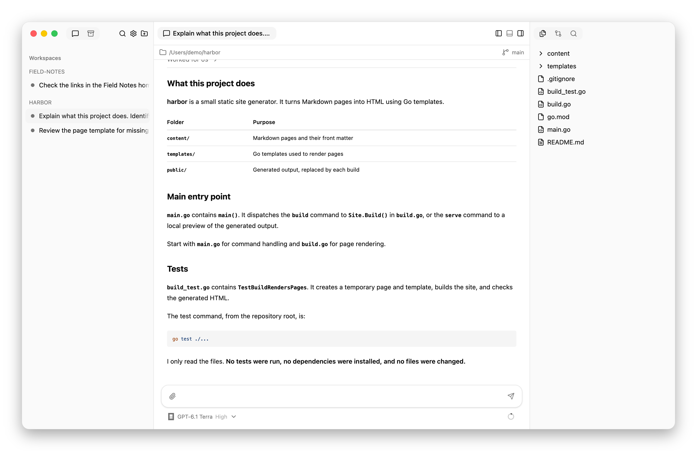
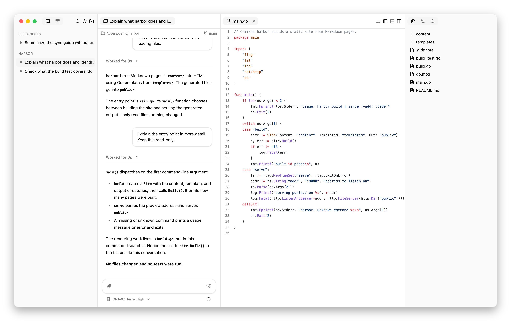

# Your first session

Use an agent to explore a project, inspect its work, and return to the
conversation. This walkthrough asks the agent not to edit anything.

**Before you start:** [install Hypercube](installation.md), set up its
background service, and sign in to at least one
[supported coding tool](harness-support.md#requirements).
Have a local project folder ready. It does not need to be a Git repository.

## 1. Open a project

Open Hypercube and choose **Add Workspace**. Select your project folder.
A workspace groups the sessions for that project in the sidebar.

## 2. Choose your coding tool

First add a model in **Settings › Agents › Models**: choose its harness, enter
the model ID exactly as the harness names it, and list its effort levels from
lowest to highest. Then choose its harness tab and model below the message box.
Leave the effort at its default. Effort controls the model's reasoning level;
the available choices depend on the harness and model.

If the folder is a Git repository, choose **Existing checkout** for this
walkthrough. The session will read the files already in that folder.

## 3. Ask about the project

Send this prompt:

> Explain what this project does. Identify its main entry point and how to run
> its tests, based on the files you find. Do not edit files, install anything,
> or run the tests.

The first prompt creates a session in the sidebar. You should see the agent's
activity appear in the conversation, followed by its answer. If it asks a
question or requests permission, the request appears above the message box.
Read the request before answering; you can deny an action you do not want.

The selected conversation is in the middle, its model is below the message
box, and the project files are on the right. Your answer will depend on your
project; this example uses a small static site generator called harbor.

## 4. Check the answer against a file

Open the **Files** panel and select a file the agent mentioned. The file opens
beside the conversation in a read-only preview.

In chat, expand **Worked for …** to see the completed turn's tool calls.
Expand a call to inspect its input and output.

Ask a follow-up:

> Explain the entry point in more detail. Keep this read-only.

The follow-up stays in the same conversation. You do not need a new session
for each question about the task.

Here, `main.go` is open beside the answer so you can check the explanation
against the code without leaving the conversation.

## 5. Leave and return

Close the app, then reopen it. Select the session in the sidebar: its
conversation is still there. Send another question to continue.

Closing the app does not stop active work. For this walkthrough, wait for the
agent to finish before leaving. See [what keeps running](lifecycle.md) for the
difference between closing a window, stopping a turn, and ending agents.

## Where to go next

- [Manage sessions](usage.md) to send corrections, change models, or archive work.
- [Work with a team](teamwork.md) to ask another agent for an independent review.
- [Sessions and working copies](introduction.md) before parallel editing.
