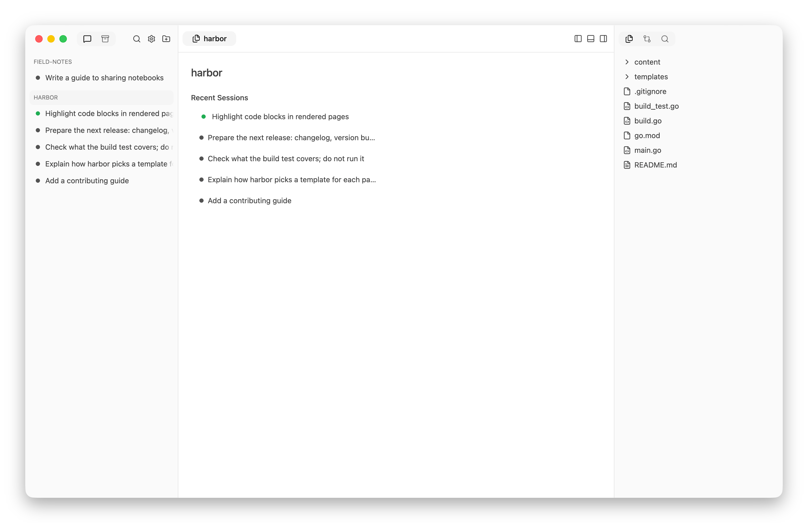
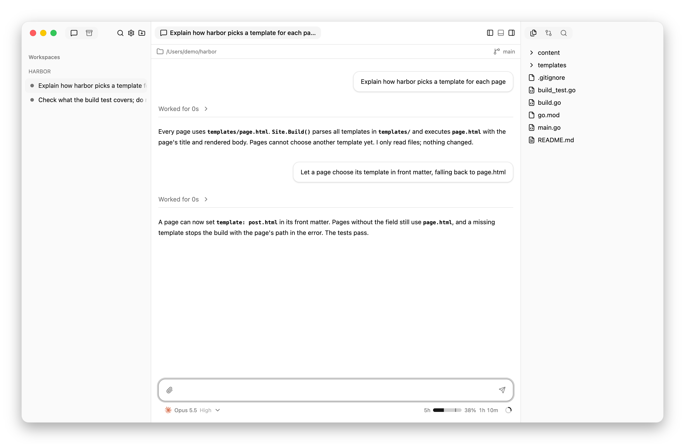
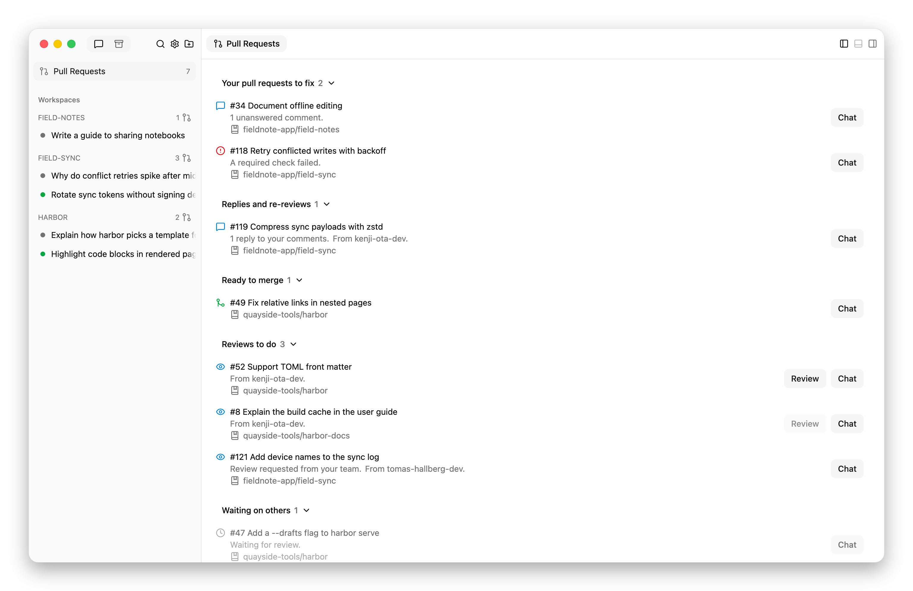

# Interface reference

Look up controls, indicators, and limits here. For procedures, use
[Manage sessions](usage.md) or [Review files and changes](review-changes.md).

## Keyboard shortcuts

**Help → Keyboard Shortcuts** lists all bindings, including sidebar navigation.
Text fields retain their editing keys.

| Action | macOS | Linux |
| --- | --- | --- |
| New session | Command+N | Ctrl+N |
| Search conversations | Command+K | Ctrl+K |
| Next / previous session | Command+Option+Down / Up | Ctrl+PageDown / PageUp |
| Focus message box | Command+L | Ctrl+L |
| Find a file | Command+P | Ctrl+P |
| Search project contents | Command+Shift+F | Ctrl+Shift+F |
| Find in a file or diff | Command+F | Ctrl+F |
| Next / previous diff change | Option+F5 / Shift+Option+F5 | F7 / Shift+F7 |
| Toggle word wrap | Option+Z | Alt+Z |
| Toggle sidebar | Command+B | Ctrl+B |
| Toggle terminal | Command+J | Ctrl+J |
| Toggle right panel | Command+Option+B | Ctrl+Alt+B |
| Settings | Command+, | Ctrl+, |
| Keyboard shortcuts | Command+/ | Ctrl+/ |

On macOS, desktop menu shortcuts also work in text fields, terminals, and
dialogs. The terminal otherwise keeps its keys, except Quick Open, Search
Files, and Settings. On Linux, terminal copy/paste uses **Ctrl+Shift+C** /
**Ctrl+Shift+V**.

## Prompts and attachments

| Control or limit | Behavior |
| --- | --- |
| Enter | Send the prompt. |
| Shift+Enter | Add a line. |
| `@` followed by a path | Show project-file suggestions; Up/Down selects, Enter or Tab inserts the path. |
| Up on the message box's first line | Recall an earlier prompt for editing. Down on the last line moves forward through history to the draft. |
| Escape in chat / Stop in an empty message box | Interrupt the current turn. |
| Image formats | PNG, JPEG, GIF, WebP. |
| Image size | At most 10 MiB total per message; multiple images and image-only prompts are supported. |
| Draft text | Survives reloads, including typed answers and a new session's first prompt. |
| Draft images | Retained across session switches, not app reloads. |

## Sidebar states

| Indicator | Meaning |
| --- | --- |
| Breathing dot | Agent is working. |
| Amber dot | An answer is needed. |
| Blue dot | Unseen reply. |
| Gray dot | Idle. |
| Dimmed outline | Ended. |
| Hollow dot | Child session; its state is shown with the same conventions. |
| Dimmed row | Agent is not running, or the session has ended. Opening a parked session resumes its conversation. |

Click a workspace heading to open its dashboard of recent sessions, including
archived sessions. The separate chevron collapses or expands its sidebar list.

<picture>
  <source media="(prefers-color-scheme: dark)" srcset="images/dashboard-dark.png">
  
</picture>

Children are grouped under their parent. An active parent's ended children
are hidden until **Show Ended Sessions** is chosen in its menu.

## Notifications

- Request cards can be answered directly, or opened with the eye button.
  Closing one hides the card without answering.
- Reply cards close after 15 seconds or when the agent works again. Hover or
  keyboard focus pauses expiry. Closing a card does not mark the reply seen.
- Desktop notifications arrive while the desktop app is open and its window
  lacks focus. Clicking one opens its session.
- Alerts that arrive while the app is closed are not replayed later. The badge
  and interface show current requests when it opens.

**Settings › Notifications** controls request alerts, reply alerts, desktop
delivery, and sound. See [configuration fields](configuration.md#notifications).

## Usage indicators

The ring below the message box shows reported context use. Hover for token
counts and reported cost; available readings
[depend on the harness](harness-support.md#usage-reports).

Subscription usage shows the shortest reported window normally, and the
longest on hover or keyboard focus. A single reported window stays visible.
Wide panes also show time until reset. The meter's mark indicates elapsed time
within the window. After reset, the last reading is dimmed and marked
**Waiting** until the harness reports again.

<picture>
  <source media="(prefers-color-scheme: dark)" srcset="images/usage-dark.png">
  
</picture>

## Files and search limits

| Feature | Scope or limit |
| --- | --- |
| Text preview | 256 KiB. |
| HTML preview | Relative resources load; scripts are disabled. |
| HTML/SVG source | Available for supported text encodings within the text limit. |
| Media | Images, audio, video, and PDFs open in the app, without the text limit. Some formats and codecs may not play. |
| Git → Uncommitted | Staged, unstaged, and untracked changes within the current view’s directory, compared with the current commit. |
| Git → Committed | Managed worktree sessions only: the branch's committed changes since the merge base with the original checkout's current branch. |
| Git → Merge into … | Top-level worktree sessions with unmerged commits, at the bottom of the Git panel. |
| Quick Open and project search | In Git: tracked and untracked files, excluding ignored and hidden paths. |
| Project text search | Case-insensitive plain text; skips files over 256 KiB; stops at 1,000 matching lines. |

On a workspace dashboard, file tools and the terminal use the workspace’s main
checkout and its currently checked-out branch. Sessions use their own working
directories.

Git rows show status colors and right-aligned added/removed line counts when
available. Select a row or its counts to open its diff. Files retains status
colors for uncommitted changes, without counts. The bar above chat shows the
working directory and current branch; click the branch to open Git.

## Saved layouts

Each session remembers tabs, editor splits, open files, expanded items, scroll
positions, and terminal visibility across switches and restarts. The app also
remembers each workspace dashboard’s tabs, splits, open files, folders, scroll
positions, and terminal visibility. Overall panel sizes, sidebar choices, and the
last selected session or workspace are saved too.

## GitHub

Hypercube uses the GitHub CLI, signed in to github.com, for a workspace when its
current branch tracks a github.com remote, or tracks no remote and has a
github.com `origin`.

Each workspace uses one gh account, chosen in this order: the checkout's
`credential.githubAccount` Git setting; the one signed-in account that can push
to the repository; or the account you choose for the workspace.

New agents and panel shells in the workspace get `GH_TOKEN` for that account, so
`gh` and Git pushes through `gh auth git-credential` use it. A running agent or
shell keeps the account it started with until it restarts.

About once a minute, Hypercube fetches each GitHub workspace's tracked remote.
It also reads the open pull requests of every signed-in account, in all
repositories, whether or not a workspace uses that account. A workspace's
dashboard shows the pull requests of its account that belong to its repository.

A GitHub workspace's dashboard shows, under its name, a link to the repository,
the account in use, and whether the checked-out branch is ahead of or behind its
upstream branch. When several signed-in accounts can push, or none can push and
several are signed in, the dashboard shows a chooser for the account instead; the choice applies to agents and panel shells
started afterward. When an update fails, the dashboard says why and shows the
time of the data it still has.

Below that, the dashboard lists the open pull requests that need the account,
under **Your move**, and the ones it is waiting on, under **Waiting on
others**. Each row shows the pull request's icon, its number and title as a link
to GitHub, why it is listed, and its author when someone else wrote it.

**Your move** lists, in this order:

- Pull requests whose review was requested from the account.
- Pull requests where the account requested changes and the author has since
  pushed or commented.
- Pull requests with replies to the account's review comments.
- The account's own pull requests that have a failed required check, merge
  conflicts, a base branch they must catch up with before merging, requested
  changes not yet answered by a push, or unanswered comments. A comment is
  unanswered when it is in an unresolved review thread and someone else spoke
  last, or when it is the latest comment in the conversation and is newer than
  both the account's last reply and the last commit. After a push answers
  requested changes, only comments newer than the last commit count as
  unanswered.
- The account's own pull requests that are ready to merge.
- Pull requests whose review was requested from one of the account's teams,
  until the account reviews them.

**Waiting on others** lists the account's other pull requests, such as drafts
and ones waiting for review or checks, and pull requests where the account
requested changes and the author has not responded. Below the lists,
**All open pull requests** opens the repository's pull requests on GitHub.

In the sidebar's Sessions tab, **Pull Requests** opens a view of the pull
requests of each signed-in account, from every repository, including ones
without a workspace, with the repository and the account on each row and a
warning for each account that could not be read. It groups them, with a count
on each heading, under **Your pull requests to fix**, **Replies and
re-reviews**, **Ready to merge**, **Reviews to do**, and **Waiting on others**.
Click a heading to collapse or expand its group; the choice is remembered. The view also shows when nothing is selected. The button
shows how many pull requests need you across accounts. Each workspace's row in
the sidebar shows the number of pull requests that need its account.

<picture>
  <source media="(prefers-color-scheme: dark)" srcset="images/pull-requests-dark.png">
  
</picture>

A row whose repository has no workspace shows **Clone**. It asks for a folder,
suggesting one beside a workspace of the same GitHub owner, and clones the
repository over HTTPS with the row's account. The clone records that account in
its own `credential.githubAccount` setting, becomes a workspace, and opens its
dashboard. The dialog shows Git's error if the clone fails, and closing it
cancels the clone. In the desktop app, **Choose…** picks the parent folder.

A pull request whose review was requested from the account shows **Review**.
It fetches the pull request's head commit, starts a new worktree session at that
commit, and opens the session. The session's model and first prompt come from
[**Settings › Review**](configuration.md#review). The pull
request's own commits do not count as the session's unmerged work, so
**Merge into …** appears only after the agent commits. On the Pull Requests
view, **Review** is disabled until a workspace holds the repository.

A session whose branch has an open pull request involving the account shows a pull request icon at the
right edge of its row. Hover over the icon for the pull request's number, title,
review, and checks.

| Icon | Pull request |
| --- | --- |
| Draft pull request, gray | A draft |
| Pull request, red | Its checks are failing |
| Pull request, amber | Changes were requested |
| Pull request, green | Approved, and its checks passed or it has none |
| Pull request, gray | Any other open pull request |
