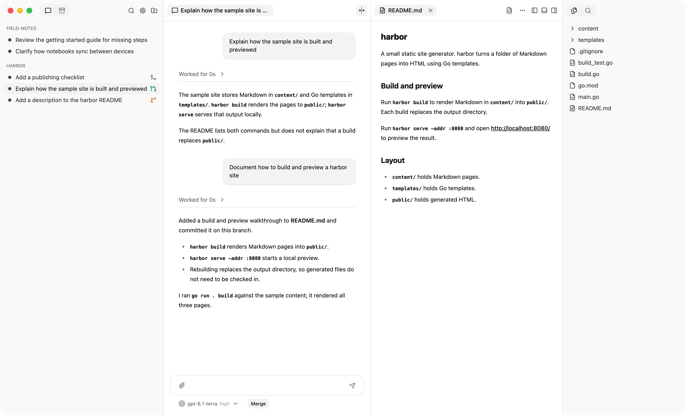

# Sessions, context, and working copies

**A separate conversation does not mean separate files.** Each session has
its own history and a working directory. Two agents can know different things
while editing the same checkout.

## Workspaces and sessions

A workspace is a project folder. For Git projects, it is the top level of the
checkout. Sessions you create yourself are top-level sessions. An agent can
create children, grouped beneath it in the sidebar; that original session is
their parent.

The parent gives each child an assignment and receives its results. The child
has a conversation you can inspect and address directly. It is not merely a
tool call hidden inside the parent's chat.

## Shared checkout or separate worktree

| Arrangement | What agents share | Best suited to |
| --- | --- | --- |
| Same checkout | Working files, staged changes, current branch. | Reviewing uncommitted changes or tightly coordinated work. |
| Separate Git worktrees | Committed starting point; each has its own working files, index, and branch. | Independent edits that will be merged later. |

In a shared checkout, a file edit or branch switch affects every session using
that folder. Separate conversations do not prevent those collisions.

A new worktree starts at the current commit, not the current uncommitted
working files. A task that depends on uncommitted changes therefore needs
either the shared checkout or a commit to start from. Ignored local files can
be supplied through [`.worktreeinclude`](configuration.md#worktreeinclude).

A child's branch merges into its parent's branch. A top-level worktree's
branch merges into the workspace's original checkout. This makes the parent
responsible for integrating delegated work before the child is ended.

Worktrees separate edits, not access permissions. These are trusted local
agents with your credentials and access to the rest of your filesystem.
Outside Git, children need existing directories instead of managed worktrees.

## Fresh and forked context

**Fresh children** receive their assignment and local instructions. They do
not inherit the parent's discussion. This gives an independent reviewer a
focused brief rather than the reasoning it is meant to challenge.

**Forked children** inherit the parent's saved native conversation at the
moment of the fork. Their visible Hypercube transcript begins with their own
assignment. A fork keeps the parent's harness, though it can choose another
model. Fresh children can use any installed harness.

Context and files are separate choices, but forks have directory constraints:

| Parent's location | Fork's location |
| --- | --- |
| Original checkout | Same folder, including uncommitted changes. |
| Managed worktree | New worktree from the parent's last commit. |

Claude Code, Codex, and Pi support the second arrangement. OpenCode requires
the parent's folder, so it can fork only from an original-checkout session,
with a version that supports native forks.

## How agents communicate

A parent can message its children and other top-level sessions, including
those in other workspaces. A child can message only its parent and cannot
create children. Ended sessions cannot receive agent messages.

Explicit messages arrive during work and appear in both conversations.
Automatic completion reports wait until the parent is idle and no child is
working, then arrive together. A child waiting for your answer, a failed
launch, or an ended child does not hold up those reports.

Each completion report contains the first 400 characters of the child's final
response, not its progress text. Longer replies include their full length;
the parent can read the full child conversation or any top-level session's
conversation when it needs more context.

Native subagents created inside a harness are different from Hypercube
children. They appear within a tool call, not as sessions in the sidebar.

For practical prompts and merge steps, see [Work with a team](teamwork.md).
