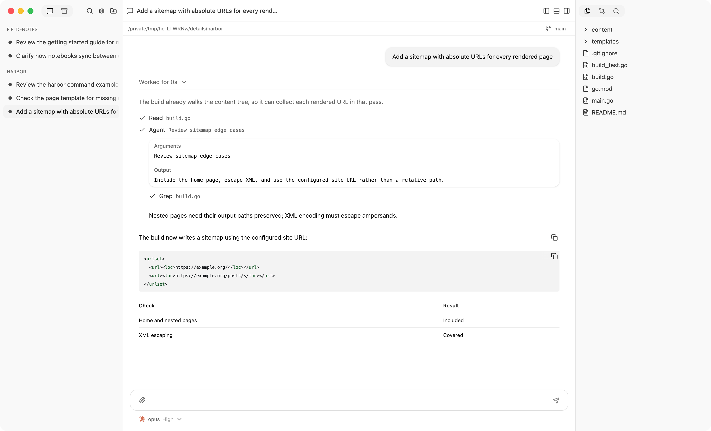
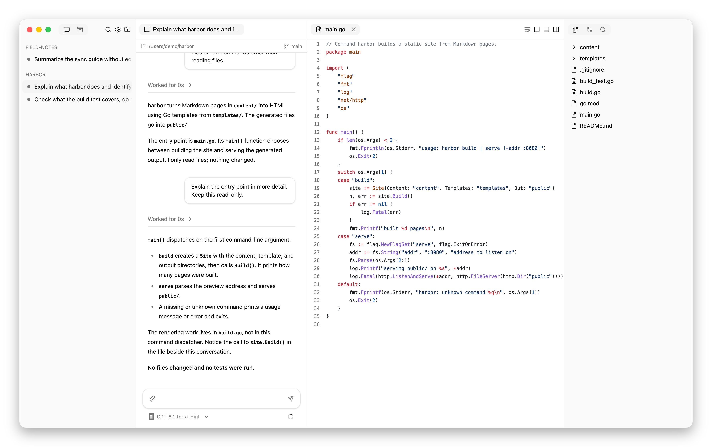
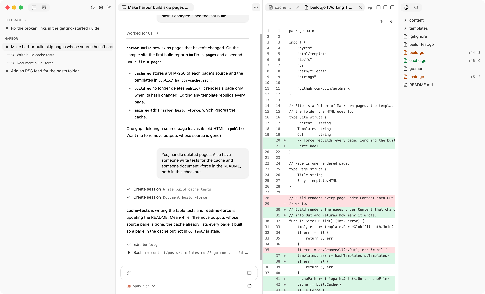

# Review files and changes

The right panel follows the selected session's working directory, or the
workspace's main checkout when its dashboard is selected. Select the view
whose output you want to inspect before opening its files.

## Inspect the agent's actions

Expand **Worked for …** in a completed turn to see reasoning, tool calls, and
messages between sessions. Expand a tool call for its input and output.
Failed and interrupted turns leave activity visible.

<picture>
  <source media="(prefers-color-scheme: dark)" srcset="images/details-dark.png">
  
</picture>

## Read a file beside the conversation

1. Open **Files** in the right panel.
2. Select a file to preview it; double-click to keep its tab open.
3. For Markdown, HTML, or SVG, switch between rendered preview and source
   when available.

Files are read-only in this view. Right-click a tab or tree row to copy its
absolute or relative path. An agent can also open a file and highlight lines
for you; those tabs appear when you view its session, even for files outside
its working directory.

<picture>
  <source media="(prefers-color-scheme: dark)" srcset="images/file-preview-dark.png">
  
</picture>

The file tab stays beside the conversation; the Files tree remains available
on the right for opening another file.

## Inspect a diff

1. Open **Git** in the right panel.
2. Choose the comparison:
   - **Uncommitted** shows staged, unstaged, and untracked changes against
     the current commit.
   - **Committed**, available for managed worktree sessions, shows the
     branch's committed changes since the common ancestor of the session's
     branch and the original checkout's current branch. Above the file list,
     it names that branch and counts the commits ahead of it.
3. Select a changed file or its right-aligned added and removed line counts
   to read its unified diff.

To inspect individual commits or other comparisons, use Git or ask the agent.

Git lists changes within the current view's directory, not the whole
containing repository. Paths are relative to that directory. Status
colors also remain visible in **Files**; line counts appear only in **Git**
and are omitted when unavailable, such as for binary files.

For a top-level worktree session, hover over its branch icon for merge status
and the number of commits not merged into the original checkout's branch.
This status refreshes when a session in that workspace finishes a turn.

<picture>
  <source media="(prefers-color-scheme: dark)" srcset="images/overview-dark.png">
  
</picture>

Added lines are green and removed lines are red. In this example, the diff
and conversation occupy separate panes while the file tree shows other edits.

The bar above chat shows the working directory and current Git branch.
Click the branch name to open the Git panel. For top-level worktree sessions
with unmerged commits, **Merge into …** at the bottom of the Git panel asks
the agent to integrate the work; it does not run a merge automatically.

Use **Command+F** on macOS or **Ctrl+F** on Linux to find text in an open
file or diff. Move between diff changes with **Option+F5** /
**Shift+Option+F5** on macOS, or **F7** / **Shift+F7** on Linux.

## Find a file or a line of text

| Goal | macOS | Linux |
| --- | --- | --- |
| Find a file by name or path | Command+P | Ctrl+P |
| Search project file contents | Command+Shift+F | Ctrl+Shift+F |
| Find in the open file or diff | Command+F | Ctrl+F |

Project search is case-insensitive plain text. Select a result to open its
line. Ignored and hidden paths are excluded in Git projects; see
[viewer and search limits](interface.md#files-and-search-limits) if an expected
file or result is missing.

## Arrange the view

Drag tabs between panes, or onto a pane edge to split the view. Drag dividers
to resize panes and panels. Toolbar buttons toggle the sidebar, terminal, and
right panel. Each session remembers its tabs, splits, and scroll positions.

Use **View → Zoom In**, **Zoom Out**, or **Actual Size** in the desktop app
to change the page size. Use **Settings › General › Appearance** to change
theme or terminal text size.
[Keyboard Shortcuts](interface.md#keyboard-shortcuts) lists navigation and
panel commands.

## Use a shell beside the conversation

Open the terminal panel for a shell in the selected session's directory.
Each session has its own shell. Hiding the panel or quitting the desktop app
leaves it running. Archiving, ending, or deleting its session ends it.

Commands run in the same working files the session uses. A local session's
shell and agent therefore share the original checkout.
