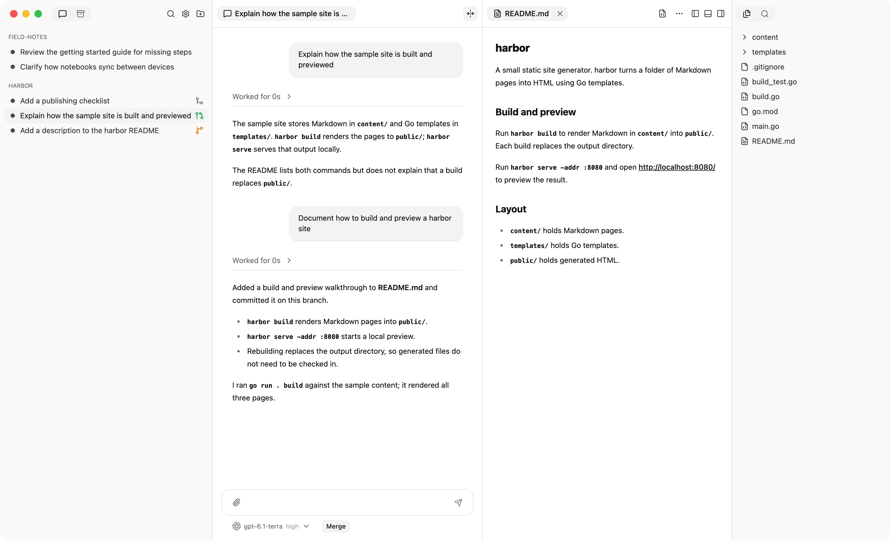
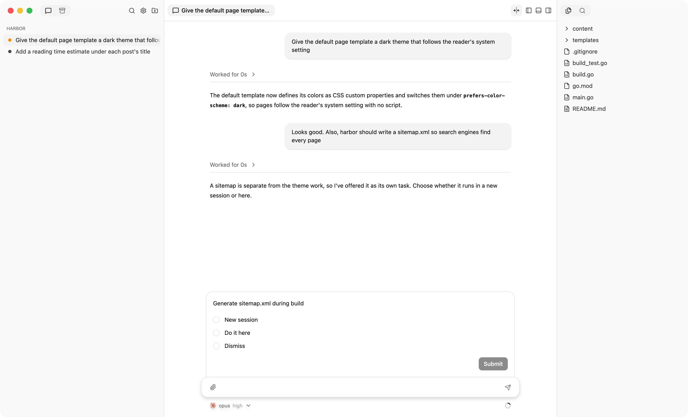
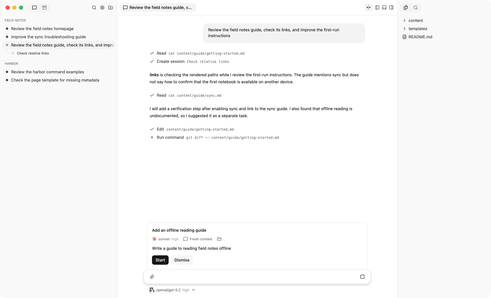

# Work with a team

Ask your session's agent to create a child session for a bounded task. The
child appears under its parent in the sidebar, with its own conversation.
You can open that conversation and speak to the child directly.

## Get an independent review

For a review of uncommitted work, the reviewer needs the same checkout:

> Ask another agent to review the uncommitted changes in this checkout.
> Give it fresh context. Have it report findings without editing files.

This shares working files, not conversation history. The parent writes the
assignment; the fresh reviewer receives that assignment and local instructions.

To review a committed branch in a separate worktree, say which branch or
commit to review. See [context and working copies](introduction.md) for the
difference between shared files and shared history.

## Delegate independent edits

In a Git workspace, ask for a fresh child in its own worktree:

> Start a child session in a separate worktree to add tests for the parser.
> It should change only parser tests, run the relevant tests, and commit its
> work on its branch. Do not merge it yet.

Give each agent clear file ownership. A new worktree starts from a commit;
it does not include the parent's uncommitted edits. Commit prerequisites
first, or use the shared checkout when the task needs those edits.

Outside Git, assign an existing directory instead; Hypercube cannot create
worktrees there. Worktrees are not sandboxes: agents retain access to your
local filesystem.



The branch icons show which sessions have separate working copies. The
selected top-level session has committed work ready for **Merge**.

### Supply ignored local files

If a worktree needs ignored configuration or dependencies:

1. Add `.worktreeinclude` at the checkout root.
2. List paths using Git ignore patterns, for example:

   ```gitignore
   .env
   node_modules/
   ```

3. Check that Git also ignores those paths. Only ignored matches are copied.
4. Create the new worktree. Existing worktrees are not updated by this file.

Copies are independent: editing either copy does not update the other.
See [worktree copy behavior](configuration.md#worktreeinclude) for details.

## Choose a child's context and model

Ask for **fresh context** for an independent assessment or a self-contained
assignment. Ask to **fork the conversation** when the child needs the parent's
saved discussion. A fork uses the same harness, and its directory choices
are constrained by that harness; see [fork behavior](introduction.md#fresh-and-forked-context).

Unless you request different settings, a child inherits the parent's harness,
model, and effort. To set a standing preference, open **Settings**, edit the
child-model guidance, and choose **Save changes**. Guidance is an instruction
to agents, not a restriction on the model selector.

## Follow progress and receive results

Open a child's chat to inspect its work or answer its requests. Messages
between parent and child appear in both conversations.

After children finish, Hypercube sends response previews to the parent when
the parent is idle and no child is working. The parent can read the full
conversations. A child waiting for your answer does not block those reports.

Send follow-ups about a child's work to that child while it remains available.
Children can message their parent but cannot create children of their own.

## Decide where a new task belongs

If you explicitly ask for delegation, the agent starts a child without asking
again. For a separate task whose placement you have not chosen, Hypercube
offers **New session** or **Do it here**. Choose where you want the work done,
or dismiss the offer. Corrections to the current task need no placement question.



Work an agent proposes on its own appears as a separate suggestion card.
Review its brief, model, and directory before choosing **Start** or
**Dismiss**. Suggestions survive reloads and do not block the parent.
Handled cards remain expandable in the conversation. A failed launch shows
an error; an available card or accepted offer can be retried after cleanup.



Unlike a task-placement question, this suggestion does not start until you
choose **Start**. Its card shows the proposed assignment and model first.

## Merge and finish a child's work

1. Review the child's files, diff, and test results.
2. Ask the parent to merge the child's branch. The child must commit first;
   the parent checkout must be ready for a merge. Ask the parent to resolve
   conflicts if needed.
3. After the branch is merged, ask the parent to end the child.

Ending a child is permanent: its conversation remains readable, but that
child cannot resume. Hypercube removes its managed worktree and branch only
after the Git checks pass. An existing directory assigned to a child is left
alone.

For a **top-level** session in its own worktree, choose **Merge** beside the
branch below the message box. It appears when there are unmerged commits and
asks the agent to commit remaining work and merge into the original checkout.
It is an instruction to the agent, not an automatic Git merge.
