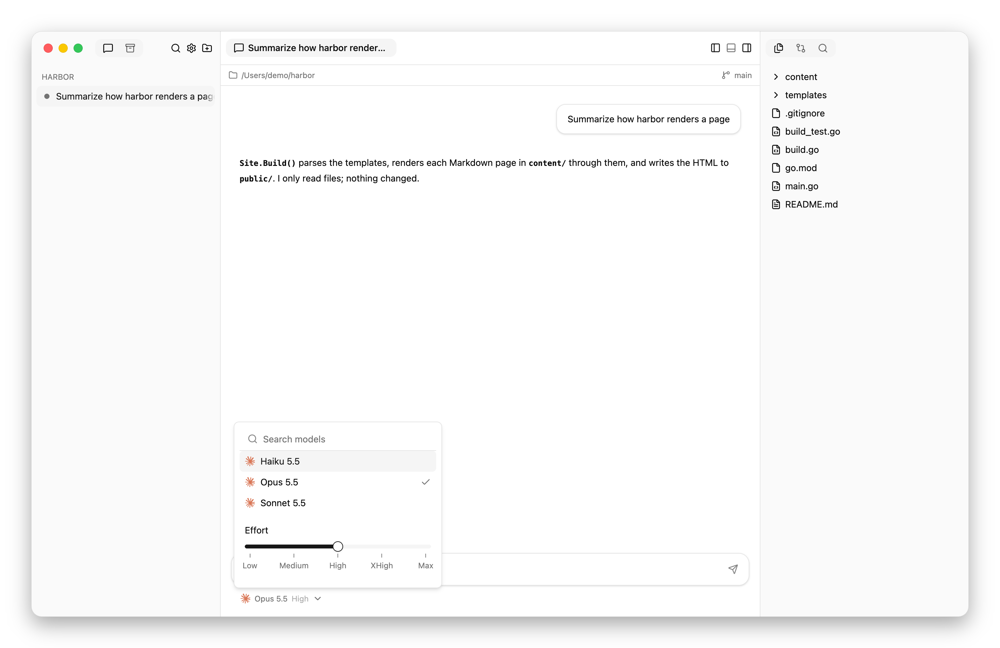
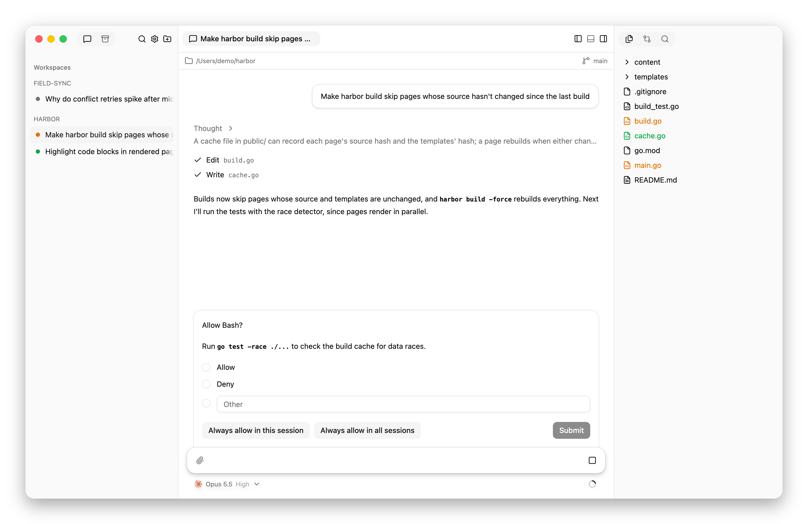
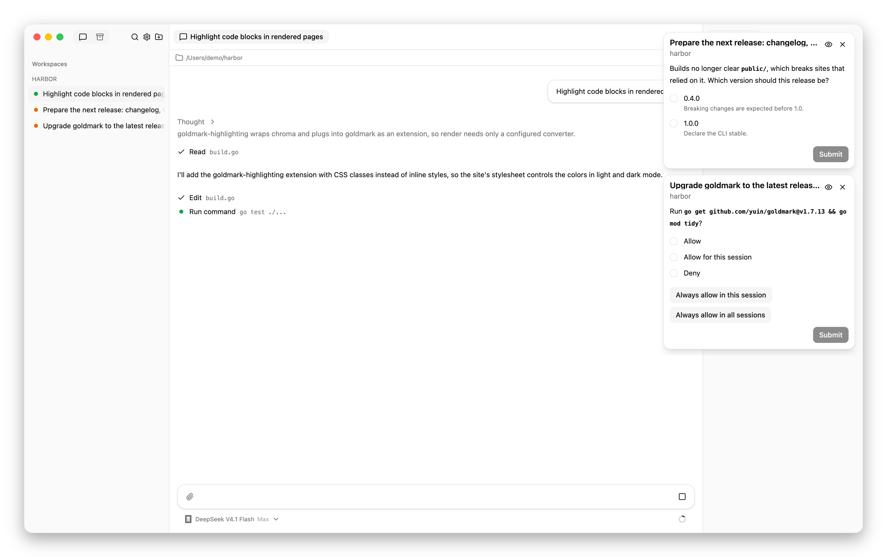
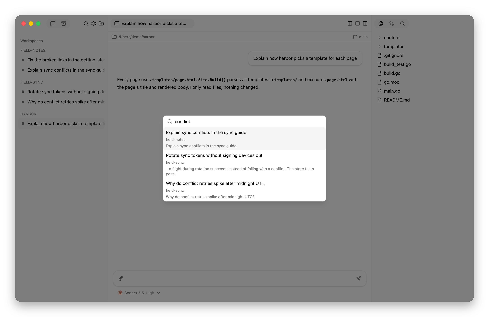

# Manage sessions

A session is one agent's conversation and working directory. For a guided
first use, follow [Your first session](getting-started.md).

## Add a workspace

A workspace is a project folder; the sidebar lists its sessions under its
name.

1. Choose **Add Workspace**, the folder button at the top of the sidebar.
2. Select the project folder.

Hypercube opens a new session in the workspace, ready for its first prompt.
For a folder inside a Git checkout, the workspace is the checkout's top-level
folder. Choosing a folder that is already a workspace opens that workspace.

Click a workspace's name to open its dashboard, or use its chevron to collapse
it; see [sidebar states](interface.md#sidebar-states).

Hover over a workspace's name for **New Session** and **More Actions**. More
Actions, or right-clicking the name, opens the workspace's menu, including
**Delete Workspace**.

## Start a session

1. Choose **Add Workspace** for a new project folder, or **New Session** in an
   existing workspace.
2. Below the message box, choose a model and an effort level
   with the slider. Models come from **Settings › Agents › Models**.
3. In a Git workspace, choose where edits will go:
   - **Existing checkout** uses the project folder, including uncommitted
     changes.
   - **New worktree** creates a separate folder and branch from the current
     commit. It does **not** include uncommitted changes.
   - **New worktree on branch…** opens **Create a branch**. Enter a **New
     branch name** and choose a **Source**: a local or remote branch, or a
     commit or ref you type and select with **Use “…”**. Choose **Save**. The
     session's worktree starts on that new branch at the source's commit; the
     branch is created when you send the prompt. The branch name must be new.
4. Send the first prompt to create the session.

New sessions initially use the workspace's newest session settings, or your
[configured default](configuration.md#session-defaults) if there are no sessions.
The initial location choice comes from **Settings › General › Default
location**.

Unsent sessions remain as **New Session** rows once you type or attach
something. Their text, settings, and location choice survive switching
sessions. Text survives reloads too; image attachments do not. Use **Discard
Draft** in the row's context menu to remove a draft.

## Correct or interrupt work

- **Send a correction:** type another message while the agent works. It can
  use the correction during that turn. OpenCode waits for running tools to
  finish before reading it at the next step; other
  [harness timing](harness-support.md#messages-and-model-changes) varies.
- **Interrupt:** press **Escape** in chat, or choose **Stop** in an empty
  message box. The turn ends, but its output remains.
- **Attach an image:** use the paperclip, paste, or drop it onto chat. You can
  send images without text. See [attachment limits](interface.md#prompts-and-attachments).

An interruption is not an undo. Inspect changes before asking the agent to
continue or reverse work.

## Change the model or effort

Use the selector below the message box to choose a model and adjust its effort
with the slider. Models come from **Settings › Agents › Models**.

<picture>
  <source media="(prefers-color-scheme: dark)" srcset="images/model-picker-dark.png">
  
</picture>

The picker lists the models for the session's harness. A session
keeps its original harness, but its model and effort can change, including
during work. The selection
survives agent restarts. A child with different settings from its parent is
marked in its composer.

The change takes effect at different times
[depending on the harness](harness-support.md#messages-and-model-changes).

## Answer a question or approval

Requests stay above the message box while you scroll. Select an answer, or
select your choices for a question with checkboxes, and choose **Submit**. Use
**Other response** when offered. Questions asked together appear one at a
time: choose **Next** after each, and **Submit** on the last sends every
answer.

A child's request also appears in its parent's chat. You can answer there
without switching sessions; the parent agent does not receive that copy.
Afterward, the answer remains in the child's history.

Read approvals before allowing them. Some offer **Always allow in this
session** or **Always allow in all sessions**. Review or remove saved choices
in **Settings › Permissions › Always Allowed Tools**.
[Permission behavior](harness-support.md#permissions) varies by harness.

<picture>
  <source media="(prefers-color-scheme: dark)" srcset="images/approval-dark.png">
  
</picture>

<picture>
  <source media="(prefers-color-scheme: dark)" srcset="images/attention-dark.png">
  
</picture>

## Find and resume earlier work

Use **Command+K** on macOS or **Ctrl+K** on Linux to search titles and
conversation text across workspaces, including archived and ended sessions.
Select an active session and send a prompt to continue its conversation.

<picture>
  <source media="(prefers-color-scheme: dark)" srcset="images/search-dark.png">
  
</picture>

A session's title comes from its first message, or from the
[utility model](configuration.md#utility-model) when one is chosen. Use
**Rename** in a session's context menu, or **F2**, to change it; a title you set
stays.
Right-click a row to open its menu.

For a failed start, open the session or send a prompt to retry. To reload an
installed plugin, choose **Restart Agent** in the session's context menu.
This cuts short a turn in progress and resumes the saved conversation.
See [session lifecycle](lifecycle.md) if you need to know what restarts.

## Archive or delete completed work

1. Commit any work you want to keep from managed worktrees, and merge or push
   it.
2. Choose **Archive Session** in the session's menu to keep searchable,
   read-only conversations while removing the family from the active list.
3. Find it later through Search or the sidebar's **Archived** tab. Choose
   **Unarchive** to make it active again.

**Discard All Changes** permanently deletes the uncommitted files and the
commits that a worktree session and its children made since the session
started. To use it, choose it in the session's menu and confirm. The session
stays active, so **Archive Session** and **Delete Session** then pass their Git
checks. See [cleanup behavior](storage.md#session-cleanup) for exactly what is
deleted and what stays.

**Delete Session** removes the family's saved conversations. It is not a
substitute for Archive Session. Managed worktrees and branches are removed only
after Git checks for uncommitted files and for commits that are neither merged
nor pushed; the original project directory is not deleted. See the
[cleanup reference](storage.md#session-cleanup) before removing a team.

## Delete a workspace

**Delete Workspace** permanently deletes every session in the workspace,
active and archived, with their children and conversations. It stops their
agents and the workspace's terminal shells, and removes their managed
worktrees and branches after Git checks. The project folder and its files are
kept.

1. Commit any work you want to keep from the workspace's managed worktrees,
   and merge or push it.
2. Right-click the workspace's name, or choose **More Actions** beside it, and
   choose **Delete Workspace**.
3. Choose **Delete** to confirm.

Sessions are deleted one family at a time. If a worktree fails the Git checks,
deletion stops at that session: families deleted before it stay deleted, and
the workspace remains with the rest. See
[Archive or delete is refused](troubleshooting.md#archive-or-delete-is-refused).
