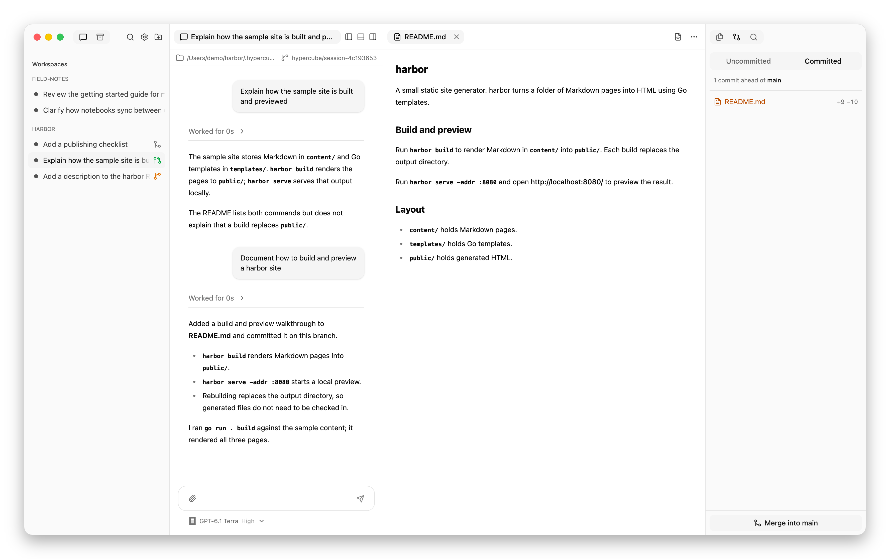
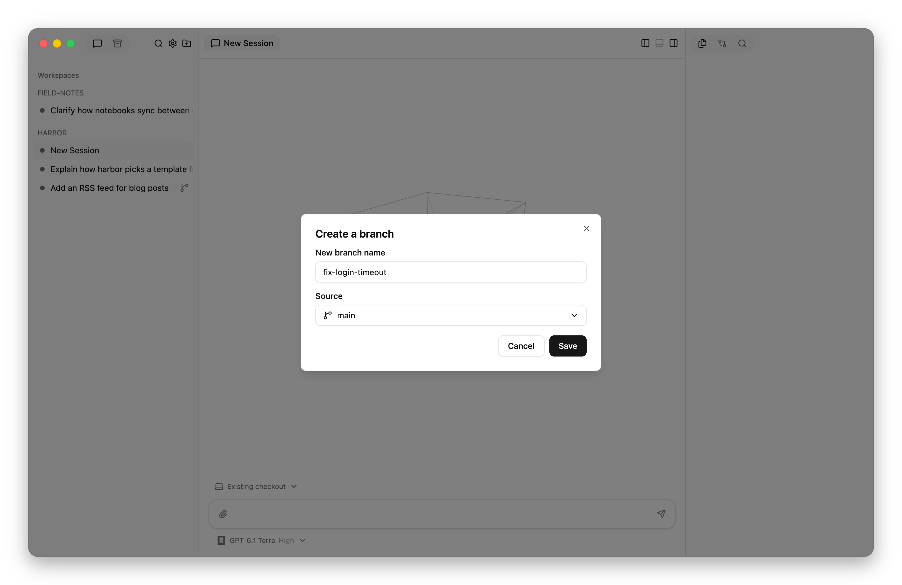
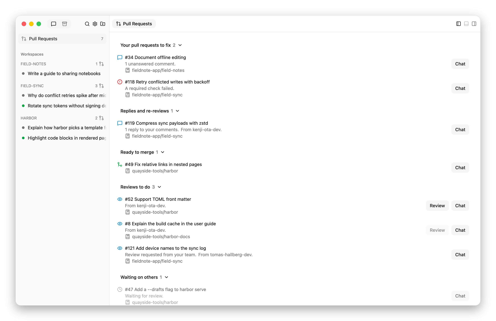
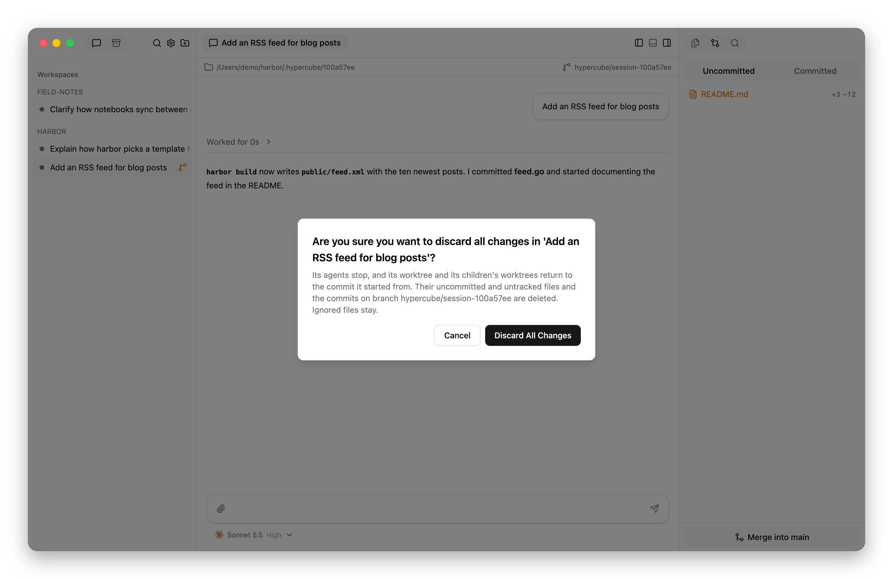

# Branch, merge, and use worktrees

This guide shows how to carry out common Git workflows with Hypercube
sessions: working on a branch, developing changes in separate worktrees,
merging them, opening and reviewing pull requests, and cleaning up afterward.

You need a workspace whose folder is a Git checkout. See
[Add a workspace](usage.md#add-a-workspace). For how shared checkouts and
separate worktrees differ, see
[Sessions, context, and working copies](introduction.md).

## Choose where a session works

When you start a session in a Git workspace, the location menu below the
message box offers three choices:

| Location | Branch | Use it to |
| --- | --- | --- |
| **Existing checkout** | The branch checked out in the workspace folder, shared with every other session there. | Work on the current branch, switch branches, or review uncommitted changes. |
| **New worktree** | A new branch, `hypercube/session-<id>`, starting at the checkout's current commit, in its own folder under `.hypercube/`. | Develop a change that you will merge later, alone or beside other changes. |
| **New worktree on branch…** | A new branch you name, starting at a branch or commit you choose, in its own folder under `.hypercube/`. | Develop a change on a branch you will push or open a pull request from. |

To make one choice the default for new sessions, set
**Settings › General › Default location**.

## Work on the checked-out branch

1. Start a session with **Existing checkout**.
2. Ask for the change. The agent edits the workspace folder directly.
3. Review the result in **Git → Uncommitted**; see
   [Inspect a diff](review-changes.md#inspect-a-diff).
4. Ask the agent to commit, or commit yourself in the session's terminal.

Every session in the existing checkout sees these edits as soon as they are
made. Give concurrent sessions there separate files, or use worktrees.

## Switch the workspace folder to another branch

Use this to continue work on a branch that already exists, or to change the
branch that **Merge into …** targets.

1. Start a session with **Existing checkout**.
2. Ask the agent to switch branches, for example:

   > Fetch and switch to the `fix-login-timeout` branch.

3. Ask for the change, review it, and have the agent commit.

Switching branches changes the files and branch of every session using the
existing checkout. Let those sessions finish their turns before you switch.
The bar above chat shows the current branch.

## Develop a change in its own worktree

1. Commit anything in the existing checkout that the change depends on. A new
   worktree starts from the current commit and leaves out uncommitted edits.
2. Start a session with **New worktree** and describe the change. To name the
   branch or start from somewhere other than the checkout's current commit,
   follow [Name the branch and its starting point](#name-the-branch-and-its-starting-point)
   instead.
3. Review the work:
   - **Git → Uncommitted** shows files the agent has not committed.
   - **Git → Committed** shows everything the branch has committed since it
     left the checkout's branch.
4. Choose **Merge into main** at the bottom of the **Git** panel. The button
   names the branch checked out in the workspace folder. It appears once the
   session has commits made after its starting point that are not on that
   branch.

   The button sends the agent a request to commit its remaining work and merge
   its branch into that branch in the workspace folder, resolving conflicts.
   Read its reply to confirm the merge.
5. Continue in the same session for more changes, and choose **Merge into
   main** again when new commits are ready.
6. When you are finished, choose **Archive Session** in the session's menu.
   Hypercube removes the worktree and its branch once their commits are
   merged.

<picture>
  <source media="(prefers-color-scheme: dark)" srcset="images/worktrees-dark.png">
  
</picture>

The branch icon on each worktree session shows whether it has uncommitted,
unmerged, or merged work. Hover over it for the number of unmerged commits.

The merge changes the branch and files in the workspace folder. If a session
there has uncommitted edits to the same files, Git stops the merge and the
agent reports why. Commit those edits, then ask the agent to try again.

Merging into the workspace folder's branch does not push it. To push, ask a
session in the existing checkout, or open the workspace's dashboard and run
`git push` in its terminal.

### Name the branch and its starting point

1. Below the message box, open the location menu and choose **New worktree on
   branch…**.
2. In **Create a branch**, enter a **New branch name**, such as
   `fix-login-timeout`. The name must not already exist.
3. Choose a **Source**: a local or remote branch, or type a commit or other
   reference and choose **Use “…”**.
4. Choose **Save**, then send the first prompt. Hypercube creates the branch at
   the source's commit and starts the session in its own worktree.

<picture>
  <source media="(prefers-color-scheme: dark)" srcset="images/new-branch-dark.png">
  
</picture>

The location button then shows the branch name. Merge status, **Merge into
…**, the pull request icon, and cleanup follow this branch.

### Merge into a branch other than main

**Merge into …** targets whatever branch is checked out in the workspace
folder. To integrate a worktree's work into a feature branch instead:

1. Switch the workspace folder to that feature branch before starting the
   worktree session, as in
   [Switch the workspace folder to another branch](#switch-the-workspace-folder-to-another-branch).
2. Start the session with **New worktree**. It starts from the feature
   branch's current commit.
3. Choose **Merge into fix-login-timeout**, or whichever branch the button
   names.

If the workspace folder changes branch while the session works, the button
follows it and names the new branch.

## Run several changes in parallel

1. Start one **New worktree** session per change. Give each change its own
   files where you can; parallel edits to the same lines produce merge
   conflicts.
2. Let each agent work and commit on its own branch.
3. Merge them one at a time with **Merge into main**. Each later merge goes
   into a branch that already holds the earlier ones, so its agent resolves
   any conflicts with them.
4. Archive each session after its work is merged.

## Bring a worktree branch up to date

When the workspace folder's branch has moved on, ask the worktree session's
agent to bring its branch up to date:

> Merge `main` into your branch and resolve any conflicts.

Ask it to rebase instead if you prefer a linear history and have not yet
shared the branch. Worktrees share the repository's branches, so the agent
sees the workspace folder's `main` without fetching.

To start from the remote's latest commits, first update the workspace folder:
open the workspace's dashboard and run `git pull` in its terminal, or ask a
session in the existing checkout to pull. The dashboard shows whether the
checked-out branch is ahead of or behind its upstream branch; see
[GitHub](interface.md#github).

## Open a pull request

These steps use GitHub through the `gh` command. Hypercube gives agents a
token for the workspace's GitHub account; see [GitHub](interface.md#github).

1. Start the session with **New worktree on branch…**, naming the branch as
   it should appear on GitHub; see
   [Name the branch and its starting point](#name-the-branch-and-its-starting-point).
2. When the change is ready, ask the agent to push its branch and open a pull
   request:

   > Push your branch and open a pull request against `main` with `gh`.

3. A pull request icon appears on the session's row. Hover over it for the
   pull request's review and check status. The right panel's **Pull Requests**
   tab lists the pull request under **To fix** when it needs you, such as after
   a failed check or a review comment.
4. To address review feedback, send the comments, or ask the agent to read
   them with `gh`, in the same session. Have it commit and push.
5. After the pull request merges on GitHub, update the workspace folder's
   branch with `git pull`, then archive the session.

## Review a pull request

When someone requests your review on GitHub, the pull request appears under
**To review** in the right panel's **Pull Requests** tab.

1. Hover over its row and choose **Review**, or right-click the row and choose
   **Review**. Hypercube fetches the pull request, starts a **New
   worktree** session at its latest commit, and sends the review prompt from
   **Settings › Review**.
2. Read the agent's findings. By default it posts nothing to GitHub.
3. Ask follow-up questions, or ask the agent to post comments with `gh` once
   you agree with them.
4. Archive the session when the review is done.

<picture>
  <source media="(prefers-color-scheme: dark)" srcset="images/pull-requests-dark.png">
  
</picture>

**Review** stays disabled on a pull request from a repository with no
workspace. Choose **Chat** on its row to clone the
repository or use a folder that already holds it; that adds the workspace, and
**Review** becomes available. To
choose the review model and prompt, see
[Review settings](configuration.md#review).

## Split a change across child sessions

A parent session can divide a change among children, each on its own branch,
and combine their work on its own branch.

1. Start the parent with **New worktree**, so the combined work stays off
   `main` until you merge it.
2. Commit anything the children need. Each child's worktree starts at the
   parent's latest commit.
3. Ask the parent to delegate, naming the parts and the files each child owns:

   > Start two child sessions in separate worktrees. One adds the
   > `--timeout` flag in `cmd/`; the other adds its tests in `cmd/cmd_test.go`.
   > Each commits on its branch. Do not merge yet.

4. Review each child's work in its own session: its **Git** panel shows
   uncommitted files, and the agent can compare the child's branch with its
   starting point for committed work.
5. Ask the parent to merge the children's branches into its branch and end
   the children. Ending a child removes its worktree and branch once its
   commits are on the parent's branch.
6. Review the combined result in the parent, then choose **Merge into main**.

For prompts, fresh and forked context, and following children's progress, see
[Work with a team](teamwork.md).

## Change several repositories together

A parent can assign children to existing directories, including checkouts of
other repositories. Hypercube creates no branch or worktree for these
children, so the brief says how to handle branches and commits.

> Start a child session in `~/src/api-client`. Create a branch named
> `add-timeout`, add the timeout option, and commit there. Do not push.

The same applies in a workspace whose folder is not a Git checkout: every
child needs a directory, and each directory is often its own repository.
Children given the same directory share its files and branch.

Ending such a child leaves its directory and branches in place.

## Set work aside and resume it

1. Make sure the session's work is safe:
   - Commit any uncommitted files.
   - Merge the commits, or push the branch to keep them on a remote branch.
2. Choose **Archive Session** in the session's menu. Hypercube stops the
   session and its children and removes their worktrees and branches after the
   Git checks in [session cleanup](storage.md#session-cleanup).
3. To resume, find the session through search or the sidebar's **Archived**
   tab and choose **Unarchive**. Hypercube recreates the worktree with its
   branch at the commit it held when archived. Only the top-level session
   returns; its children stay ended and read-only.

If archiving is refused, see
[Archive or delete is refused](troubleshooting.md#archive-or-delete-is-refused).

## Discard a worktree's changes

**Discard All Changes** permanently deletes the uncommitted files and the
commits that a worktree session and its children made since the session
started. It also stops their agents. Ignored files, such as copies from
`.worktreeinclude`, stay. See [cleanup behavior](storage.md#session-cleanup)
for exactly what is deleted.

1. Right-click the session in the sidebar and choose **Discard All Changes**.
2. Read the confirmation and choose **Discard All Changes**.

<picture>
  <source media="(prefers-color-scheme: dark)" srcset="images/discard-dark.png">
  
</picture>

The session stays active, at the commit it started from. Continue working in
it, or choose **Archive Session** or **Delete Session**; with nothing left to
lose, the Git checks pass.
